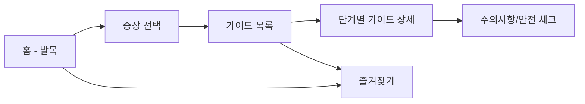

# 마산대학교 X ANCHOR 사업 — [STEP 1] 2026 마산대학교 해커톤 팀 아이디어 PRD

| 항목 | 내용 |
|---|---|
| 팀명 | 테이프핏 |
| 팀장 | 오준혁 |
| 팀원 (총 3명) | 오준혁, 장아영, 송수민 |
| 서비스명 | TapeFit (테이프핏) — 테이핑 가이드 앱 |

---

## 1. 문제 & 배경 (Problem)

**해결하고 싶은 문제**
- 운동·일상 중 발목, 무릎, 어깨, 손목 등을 다쳤을 때 테이핑이 도움이 되지만, 올바른 방법은 전문가(트레이너, 물리치료사)만 알고 있는 경우가 많습니다.
- 테이핑 정보가 유튜브, 블로그, 커뮤니티, 제품 설명서 등에 **흩어져 있고**, 출처와 신뢰도가 제각각이라 일반인이 정확한 방법을 찾기 어렵습니다.

**현재 사용자가 겪는 불편**
- 검색해도 영상이 길고, 부위·증상·테이프 종류별 정보가 섞여 있어 원하는 정보를 찾기 힘듭니다.
- 테이프 종류(키네시올로지 테이프, 리지드 테이프 등)와 당김 강도, 붙이는 방향·순서를 몰라 잘못 붙이면 효과가 없거나 피부 트러블·혈액순환 문제가 생길 수 있습니다.
- 운동 중이나 부상 직후에는 영상을 오래 볼 여유가 없고, 따라 하기 쉬운 단계별 안내가 부족합니다.

**문제 확인 계획 (사용자 인터뷰)**
- 주변 운동인 3~5명에게 "최근 테이핑 경험, 정보를 찾은 방법, 가장 어려웠던 점"을 질문하고, 공통된 불편을 정리해 이 항목에 반영합니다.
- 현재까지 3명 진행했으며, 가능하면 추가로 받을 예정입니다.

**인터뷰 결과 (응답자 3명, 모두 발목 부상 경험, 같은 질문 3개)**

질문: ① 테이핑 방법을 어디서 찾았나요? ② 찾는 과정에서 가장 어려웠던 점은? ③ 결국 테이핑을 했나요, 포기했나요?

| 응답자 | 상황 | ① 검색 경로 | ② 가장 어려웠던 점 | ③ 결과 |
|---|---|---|---|---|
| 참가자 1 | 운동 중 실수로 발목을 다침 | 유튜브 | 유튜브 영상이 여러 가지라 어떤 영상이 제대로 된 방법인지 확인하기 어려웠음 | 겨우 붙임 |
| 참가자 2 | 계단에서 넘어져 발목을 다침 | 네이버 블로그 | 블로그 글이 여러 가지라 어떤 글이 제대로 된 방법인지 확인하기 어려웠음 | 포기함 |
| 참가자 3 | MMA 운동 중 케이지에서 발목을 삠 | MMA 운동 동료 | 제대로 붙인 것인지 불안했음 | 겨우 붙임 |

- 공통점: 참가자 1·2는 각자 본 자료(영상 / 블로그 글)가 여러 가지여서 어느 것이 제대로 된 방법인지 판단하기 어려웠다고 답했고, 참가자 3은 붙인 뒤에도 제대로 붙였는지 불안했다고 답했습니다. 세 명 모두 "내가 한 방법이 맞는지 확신하기 어렵다"는 점이 공통입니다. 참가자 1·3은 겨우 붙였습니다.
- 차이점: 검색 경로가 유튜브(참가자 1), 네이버 블로그(참가자 2), 운동 동료(참가자 3)로 서로 달랐습니다. 참가자 2는 방법을 몰라 포기했고, 참가자 1·3은 어렵게 테이핑을 했습니다.
- 앱 기능과의 연결: "여러 자료 중 무엇이 맞는지 판단 어려움" → 출처와 검수 상태를 표시한 가이드 1가지 제공, "방법을 몰라 포기" → 따라 하기 쉬운 단계별 가이드 제공
- 한계: 응답자가 3명이라 문제의 발생 빈도는 확인하지 못했습니다. 다만 서울대병원 의학정보(S6)는 발목염좌를 흔한 손상으로 설명하며, 스포츠 활동뿐 아니라 계단 등 일상 동작에서도 쉽게 발생한다고 합니다. 추가 인터뷰와 사용자 테스트로 보완합니다.

## 2. 타겟 사용자 (User)

**주요 사용자**
- 헬스, 러닝, 축구, 농구, 클라이밍 등 운동을 즐기는 대학생 및 20~30대 일반인
- 경미한 근육통·관절 불편을 겪는 직장인, 학생
- 전문 트레이너·치료사를 매번 찾아가기 어려운 사람

**사용자 특징**
- 스마트폰으로 정보를 찾는 데 익숙하며 짧고 직관적인 가이드를 선호
- 테이핑 경험이 적거나 없어 용어가 낯섦
- 비용·시간 때문에 즉각적이고 간편한 자기 관리 방법을 원함

## 3. 목표 & 가치 (Goal)

**제공 가치**
- 흩어진 테이핑 정보를 **한 곳에 통합**하여 검색 시간을 줄임
- 누구나 따라 할 수 있는 **단계별·시각적 가이드**로 올바른 테이핑 지원
- 부위·증상·테이프 종류에 맞는 맞춤 추천과 주의사항 제공으로 안전성 향상

**한 줄 요약**
> "전문가의 테이핑 노하우를, 누구나 쉽고 간편하게 — 부위만 고르면 바로 따라 하는 테이핑 가이드 앱"

## 4. 핵심 기능 (Features)

**기능 우선순위**

| 우선순위 | 기능 | 비고 |
|---|---|---|
| P0 (MVP 필수) | 증상 선택, 단계별 가이드, 안전 주의사항 | 1개 부위(발목)로 전체 흐름 완성 |
| P1 (2일 내 가능하면) | 즐겨찾기 | 발목 가이드 완성 후 추가 |
| P2 (추후 수정 예정) | 부위 선택 화면 + 무릎·손목·어깨·허리 확대, 3D 모델링, 음성 가이드, 근처 병원 안내 | 2일 내 제작이 어려워 해커톤 이후 단계적 개발 |

1. **부위·증상 기반 테이핑 가이드**
   - (MVP는 발목만 제공, 부위 선택·타 부위는 추후 수정 예정) 부위(발목, 무릎, 어깨, 손목, 허리 등) → 증상(염좌, 통증, 불안정감 등) 선택 → 맞는 테이핑 방법 제시
2. **단계별 따라하기 (정적 이미지 + 텍스트 카드, 3D·음성은 추후 수정 예정)**
   - 준비물, 테이프 길이·자르는 방법, 당김 강도(%), 붙이는 순서와 방향을 카드형 UI로 한 단계씩 안내
3. **안전 체크 & 주의사항**
   - 피부 알레르기, 붙이면 안 되는 경우, 통증이 심할 때 병원 방문 권고 등 사전 체크리스트 제공
4. 즐겨찾기 (P1) / 테이프 종류 설명, 근처 정형외과·물리치료 안내 (P2, 추후 수정 예정)

**차별점**
- 흩어진 정보를 정리·검수하여 통합한 단일 서비스 (영상 검색 → 앱 내 즉시 해결)
- 전문용어 없이 초보자 눈높이의 UI/UX
- 모든 가이드에 출처와 검수 상태를 표시해 신뢰도 확보

**콘텐츠 검수 기준**
- 출처: 공신력 있는 자료(의료·스포츠의학 기관 자료, 테이프 제조사 공식 사용법)를 2개 이상 교차 확인한 내용만 수록합니다.
- 표시: 각 가이드에 출처 목록과 검수 일자를 표기합니다.
- 전문가 검수: 팀원 송수민(스포츠테이핑 자격증 보유)이 가이드의 단계·당김 강도·주의사항을 검수합니다. 추가로 물리치료사·트레이너 외부 자문을 요청할 계획이며, 실제 결과는 받은 후 기재합니다.
- 검수 결과: (진행 후 기재 — 검수 일자, 수정한 내용)

**4-1. 발목 가이드 내용과 출처 연결 (MVP 콘텐츠)**

MVP는 **"발목 불안정감 (가벼운 염좌 후)"** 한 가지 증상으로 제한합니다. (리지드 테이프 + 언더랩, 5단계) "발목 뻐근함·가벼운 통증"(키네시올로지 테이프)은 추후 수정 예정입니다. 출처 번호(S1~S6)의 상세 내용은 "7. 참고 자료" 표에 있습니다.

**단계별 안내 문구와 출처**

| 단계 | 안내 문구 | 당김 강도 | 출처 |
|---|---|---|---|
| 1. 피부 준비 | 땀과 오염을 씻고 말리세요. 체모는 제거하고, 상처는 거즈로 덮으세요. 붙이는 동안 움직이지 마세요. | 없음 | S3 |
| 2. 앵커 | 종아리 근육 바로 아래쪽에 테이프를 2~3줄 둘러 시작점을 고정하세요. | 당기지 않음 | S3(앵커의 역할), S5(종아리 근육 바로 아래쪽에 고정 스트립 2~3개), 송수민이 자격증 과정 수강자료와 S5를 비교해 같다고 확인 |
| 3. 스터럽 | 발 안쪽에서 발뒤꿈치 아래를 지나 바깥쪽으로 U자로 붙여 인대를 지지하세요. 총 3줄을 붙입니다. | 약하게 | S3, S5(스터럽 3개, 내번 염좌는 안쪽 위에서 발뒤꿈치 아래를 지나 바깥쪽 위로), 송수민이 자격증 과정 수강자료와 S5를 비교해 같다고 확인 |
| 4. 호스슈 | 스터럽 위에 말발굽 모양으로 붙여 발목이 좌우로 흔들리지 않게 하세요. | 약하게 | S3 붙이는 위치는 S4 검수 |
| 5. 마무리 확인 | 앵커로 끝맺고, 조이거나 아프면 떼고 다시 붙이세요. 피부가 창백하거나 테이프가 파고들면 너무 강한 것입니다. | 당기지 않음 | S3 |

**주의사항과 출처**

| 주의사항 | 출처 |
|---|---|
| 조이거나 아프면 다시 붙이기, 붙인 테이프 위에 덧붙이지 않기, 구김 없이 붙이기 | S3 |
| 매일 반복해 붙인다면 피부 보호를 위해 언더랩 사용 | S3 |
| 골절·탈구가 의심되면 테이핑만 믿고 움직이지 않기 | S3 |
| 붓기·멍이 심하거나 체중을 실을 수 없으면 병원 진료 (증상의 심한 정도가 손상 정도와 반드시 일치하지 않고 골절이 동반될 수 있으므로, 다친 직후에는 전문의 진료를 권고) | S6 |
| 붙이기 전 알레르기·피부 상처(베인 상처, 찰과상, 물집) 확인, 붙인 뒤 감각·혈액순환(저림, 색 변화) 확인 | S5 |
| 피부 이상 시 붙이지 않기, 저림·색 변화 시 즉시 제거, 하루 이내 제거 | S4 (송수민 검수) |

- S3에 없는 내용 중 앵커 위치·줄 수, 스터럽 줄 수는 S5로 확인했고 송수민도 자격증 과정 수강자료와 같다고 확인했습니다. 호스슈 위치와 하루 이내 제거는 S3·S5 모두에 없어 임의로 출처를 연결하지 않고 송수민 검수로 확정합니다.
- S5는 팀원이 제공한 번역본 기준으로 대조했습니다. S5는 운동 지도자용 발목 지지 테이핑 절차이며, 당김 강도는 설명하지 않아 당김 강도는 S3와 송수민 검수로 확인합니다. S5가 안내하는 테이핑 전 알레르기·피부 상처 확인, 테이핑 후 운동 기능·감각·혈액순환 확인은 주의사항으로 반영합니다.

- 앱 화면에는 가이드마다 "출처"와 "검수 상태(전문가 검수 전 / 검수 완료 + 일자)"를 표시합니다.
- 출처로 확인되지 않거나 송수민 검수에서 맞지 않는다고 판단된 단계는 수정하거나 삭제합니다.

**초보자 테스트 전 확인 원칙 (출처·검수 표시와 보수적 문구)**
- 사용자 테스트 전에 5단계와 주의사항 각각에 출처(S3, S5, S6)와 검수 상태(송수민 검수 전 / 검수 완료 + 일자)를 표시합니다.
- S3·S6에서 확인된 내용만 확정 문구로 사용합니다. S3에 없는 세부 내용은 송수민 검수가 끝나기 전에는 안내에서 제외하고, 아래 보수적 문구로 대체합니다.

| 검수 전 세부 내용 | 검수 전 대체 문구 (테스트 버전) |
|---|---|
| 앵커의 정확한 위치와 줄 수 | S5로 확인됨(종아리 근육 바로 아래쪽, 2~3줄). 송수민이 자격증 과정 수강자료와 S5를 비교해 같다고 확인 |
| 스터럽 줄 수 | S5로 확인됨(3줄). 송수민이 자격증 과정 수강자료와 S5를 비교해 같다고 확인 |
| 호스슈 붙이는 위치 | 위치를 단정하지 않고 "스터럽을 고정하는 용도"로만 안내 |
| 하루 이내 제거 | "붙인 채로 오래 두지 말고, 불편하면 바로 제거"로 안내 |
| 피부 이상·저림·색 변화 | "붙이지 않기·즉시 제거" (보수적 방향이라 그대로 사용) |

- 송수민 검수가 끝나면 위 세부 내용을 확정해 문구를 바꾸고, 검수 일자를 표시합니다. 실제 검수 결과는 받은 후 5-1에 기재합니다.


## 5. 개발 범위 & 계획 (Scope)

**구현 목표 (MVP, 2일 기준)**
- 1차 목표: 발목 1개 부위로 증상 선택 → 단계별 가이드 → 안전 주의사항까지 전체 흐름 완성 (정적 이미지 + 로컬 JSON)
- 2차 목표(2일 내 가능하면): 즐겨찾기
- 추후 수정 예정 (2일 내 제작이 어려운 부분): 부위 선택 화면, 무릎·손목·어깨·허리 콘텐츠, 3D 모델링, 음성 가이드
- **중장기 계획:** 해커톤 이후 1단계 무릎·손목 추가 → 2단계 어깨·허리, 부위 선택 화면 → 3단계 3D·음성 가이드. 일정은 전문가 검수 속도에 따라 조정합니다.
- **최소 시연 기준:** 앱을 열어 발목 가이드를 끝까지 따라 할 수 있는 상태

**사용 기술/도구 (확정)**
- 프론트엔드: Flutter (안드로이드/iOS 동시 지원)
- 데이터: 앱 내 로컬 JSON (별도 서버·Firebase는 추후 계획)
- AI 활용: github copilot, Codex를 활용한 코드 작성 및 개발 자동화
-  협업: GitHub

**일정 및 역할 분담 (안)**

| 시간 | 내용 | 담당 |
|---|---|---|
| 1일차 오전 | 콘텐츠 입력 (4-1에서 정리한 단계·주의사항, 검수 전 항목은 보수적 문구), 화면 설계 | 송수민, 장아영 |
| 1일차 오후 | 최소 흐름 개발: ① 증상 선택 → ② 안전 체크 → ③ 단계별 가이드 | 오준혁, 송수민 |
| 2일차 오전 | ④ 완료 화면, 최소 흐름 전체 점검 → 통과 후에만 디자인 적용, 즐겨찾기 | 장아영, 오준혁 |
| 2일차 오후 | 사용자 테스트, 수정, 발표 준비 | 전원 |

- 진행 원칙: 증상 선택부터 마지막 안내까지 작동하는 최소 흐름(①~④)을 먼저 완성하고, 시간이 남을 때만 디자인 개선과 즐겨찾기를 진행합니다.
- 안전 콘텐츠는 해커톤 전에 4-1에서 정리해 두므로, 해커톤 중에는 새로 작성하지 않고 입력만 합니다. 송수민 검수 결과가 나오면 문구만 교체합니다.
- 일정이 밀리면 즐겨찾기와 디자인 개선을 제외하고, 사용자 테스트는 참가자 수를 줄여(최소 3명) 진행합니다.

**화면 흐름도 (초안)**



**주요 화면 구성 (계획)**

해커톤 MVP 1차 목표인 발목 가이드의 핵심 흐름은 다음 4개 화면으로 구성합니다. (콘텐츠는 전문가 검수 후 확정)

| 순서 | 화면 | 내용 |
|---|---|---|
| ① | 증상 선택 | 증상에 맞는 테이프 종류와 방법을 고릅니다. |
| ② | 안전 체크 | 주의사항을 확인해야 가이드를 시작할 수 있습니다. |
| ③ | 단계별 가이드 | 그림으로 테이프 위치를 보여 주고, 단계별 설명과 당김 강도를 안내합니다. 우측 상단 ☆로 즐겨찾기 할 수 있습니다. |
| ④ | 완료 | 마무리 확인 사항을 안내합니다. |

**화면별 완료 조건과 점검 시점**

| 화면 | 완료 조건 | 점검 시점 |
|---|---|---|
| ① 증상 선택 | "발목 불안정감"을 눌러 ②로 이동한다 | 1일차 오후 |
| ② 안전 체크 | 주의사항을 모두 체크해야 "가이드 시작" 버튼이 활성화된다 | 1일차 오후 |
| ③ 단계별 가이드 | 5단계를 이전·다음으로 이동하며 각 단계의 문구·당김 강도·출처가 표시된다 | 1일차 오후 |
| ④ 완료 | 마무리 확인 사항이 표시되고 홈으로 돌아갈 수 있다 | 2일차 오전 |
| 즐겨찾기 (2차 목표) | ☆로 저장하고 즐겨찾기 목록에서 다시 열 수 있다 | 2일차 오전 (시간이 부족하면 제외) |

- 점검 방법: 각 시점이 끝날 때 팀원이 해당 화면을 직접 눌러 보며 완료 조건을 확인하고, 충족하지 못한 화면은 다음 작업보다 먼저 수정합니다.
- 2일차 오후 사용자 테스트 전까지 ①~④가 모두 완료 조건을 충족하는 것을 최소 시연 기준으로 삼습니다.

## 5-1. 목표 달성 검증 방법 (Validation)

**전문가 검수 (팀 내)**
- 스포츠테이핑 자격증을 보유한 팀원 송수민이 발목 가이드(5단계)를 자격증 교육 내용 기준으로 검토합니다.
- 검토 항목: 테이프 종류, 붙이는 순서·방향, 당김 강도, 안전 주의사항의 정확성
- 검토 결과: 송수민은 스포츠테이핑 자격증을 취득했으며, 자격증 과정의 실습에서 익힌 발목 테이핑 방법을 기준으로 가이드를 검토할 예정입니다. 송수민이 자격증 취득 과정의 수강자료와 S5(앵커·스터럽 등 발목 지지 테이핑 절차)를 비교해 내용이 같다고 확인했습니다. 호스슈 위치, 당김 강도, 하루 이내 제거 등 나머지 항목별 확인·수정 내용: (진행 후 기재 — 검토 일자, 수정한 내용, 확인하지 못한 항목)

**사용자 테스트**
- 참가자: 테이핑 경험이 없거나 적은 사용자 3~5명 (교내 학생 등), 2일차 오후에 진행합니다. (장소는 확정 후 기재)
- 과제: "앱을 열어 발목 불안정감 가이드를 끝까지 따라 해 보기"를 요청하고 관찰합니다.
- 측정: 완료 여부는 관찰로, 소요 시간은 스톱워치로, 이해도는 5점 설문 1문항으로 기록합니다.
- 안전 이해 확인: 가이드를 끝낸 뒤 핵심 주의사항 3문항을 묻고 정답 수를 기록합니다. ① 골절·탈구가 의심되면 어떻게 하나요? (테이핑만 믿고 움직이지 않는다 — S3) ② 붓기·멍이 심하거나 체중을 싣기 힘들면 어떻게 하나요? (테이핑 전에 전문의 진료 — S6) ③ 붙인 뒤 조이거나 아프면 어떻게 하나요? (떼고 다시 붙인다 — S3)

**성공 기준**

| 지표 | 측정 방법 | 목표 |
|---|---|---|
| 가이드 완료율 | 증상 선택부터 마지막 단계까지 도달한 사용자 비율 | 80% 이상 |
| 정보 탐색 시간 | 같은 참가자가 같은 과제로 앱과 기존 검색(유튜브·블로그)에서 방법을 찾는 시간 비교 (비교 조건은 아래 참고) | 50% 이상 단축 |
| 이해도 | 테스트 후 "따라 하기 쉬웠다" 5점 척도 설문 | 평균 4점 이상 |
| 안전 체크 이해 | 안전 이해 확인 3문항의 정답 여부 (주의사항 화면 확인 여부도 함께 기록) | 참가자 전원이 3문항 모두 정답 (100%) |

**사용자 테스트 기록 양식 (테스트 후 기재 예정)**

| 참가자 | 가이드 완료 여부 | 소요 시간 | 따라 하기 쉬웠다 (1~5점) | 정보 탐색 시간 (앱 / 기존 검색) | 안전 이해 정답 수 (3문항) | 막히거나 혼란스러웠던 단계 |
|---|---|---|---|---|---|---|
| 1 | (진행 후 기재) | (진행 후 기재) | (진행 후 기재) | (진행 후 기재) | (진행 후 기재) | (진행 후 기재) |
| 2 | (진행 후 기재) | (진행 후 기재) | (진행 후 기재) | (진행 후 기재) | (진행 후 기재) | (진행 후 기재) |
| 3 | (진행 후 기재) | (진행 후 기재) | (진행 후 기재) | (진행 후 기재) | (진행 후 기재) | (진행 후 기재) |

- 요약: (진행 후 기재 — 참여 인원, 완료율, 평균 소요 시간, 설문 평균)
- 수정 규칙: 2명 이상이 막히거나 혼란스러워한 단계는 문구·그림을 수정하고, 수정한 내용을 이 표 아래에 기재합니다.
- 비교 측정(정보 탐색 시간) 조건: 같은 참가자가 같은 과제("발목 불안정감 후 테이핑 방법 찾기")를 앱과 기존 검색(유튜브·블로그 중 자유 선택)으로 각각 수행합니다. 종료 기준은 "붙이는 순서를 마지막 단계까지 말로 설명할 수 있을 때"로 같게 하고, 먼저 한 방법에 익숙해지는 영향을 줄이기 위해 앱을 먼저 하는 참가자와 검색을 먼저 하는 참가자를 번갈아 배정합니다. 시간은 스톱워치로 재고, 상한은 10분으로 둡니다.

## 6. 기타 참고사항

- 제공 정보는 일반 참고용이며 의학적 진단·치료를 대체하지 않습니다. 증상이 심하면 전문가 진료를 권고합니다.
- 콘텐츠는 공신력 있는 자료와 전문가(물리치료사·트레이너) 자문으로 검증할 계획입니다.
- 추후 AI 기반 부위 인식, 맞춤 추천, 전문가 연결 서비스로 확장 가능합니다.
- 키네시올로지 테이프 단독 효과에 대한 근거는 연구마다 다릅니다. 이에 따라 앱은 "치료"가 아닌 "따라 하기 쉬운 참고 가이드"로 제공하고, 통증·붓기가 심하면 진료를 먼저 권고합니다.

## 6-1. 샘플 데이터 (source_sample)

제출 형식상 코드 파일을 따로 낼 수 없는 경우를 대비해, 앱이 읽는 가이드 데이터(`guides.json`) 전체를 아래에 텍스트로 싣습니다. 내용은 4-1과 같고 송수민 검수 전입니다. 이 데이터로 부위 선택 → 증상 선택 → 안전 체크 → 단계별 가이드 → 즐겨찾기 화면을 보여 주는 동작 샘플(HTML)을 만들었으며, 정식 앱은 해커톤 기간에 개발할 계획입니다. 이 문서의 샘플은 데이터이며 구현이 끝난 앱이 아닙니다.

```json
{
  "disclaimer": "일반 참고용 샘플입니다. 송수민 검수 전이며 의학적 진단·치료를 대체하지 않습니다. 증상이 심하면 진료를 받으세요.",
  "bodyParts": [
    {
      "id": "ankle",
      "name": "발목",
      "available": true,
      "symptoms": [
        {
          "id": "ankle_instability",
          "name": "발목 불안정감 (가벼운 염좌 후)",
          "tape": "리지드 테이프 + 언더랩",
          "tapeNeeded": "리지드 테이프, 언더랩, 가위",
          "source": "S3 서울대병원 테이핑 요법, S5 Athletic Therapy Skills, S6 서울대병원 발목염좌 (송수민 검수 전)",
          "steps": [
            {
              "title": "피부 준비",
              "body": "땀과 오염을 씻고 말리세요. 체모는 제거하고, 상처는 거즈로 덮으세요. 붙이는 동안 움직이지 마세요.",
              "tension": "없음",
              "tape": []
            },
            {
              "title": "앵커",
              "body": "종아리 근육 바로 아래쪽에 테이프를 2~3줄 둘러 시작점을 고정하세요.",
              "tension": "당기지 않음",
              "tape": [[[80, 96], [130, 96]]]
            },
            {
              "title": "스터럽",
              "body": "발 안쪽에서 발뒤꿈치 아래를 지나 바깥쪽으로 U자로 붙여 인대를 지지하세요. 총 3줄을 붙입니다.",
              "tension": "약하게",
              "tape": [[[82, 96], [82, 150], [86, 190], [105, 206], [124, 190], [128, 150], [128, 96]]]
            },
            {
              "title": "호스슈",
              "body": "스터럽 위에 말발굽 모양으로 붙여 발목이 좌우로 흔들리지 않게 하세요. (붙이는 위치는 송수민 검수 예정)",
              "tension": "약하게",
              "tape": [[[128, 150], [112, 178], [96, 186], [82, 160]]]
            },
            {
              "title": "마무리 확인",
              "body": "앵커로 끝맺고, 조이거나 아프면 떼고 다시 붙이세요. 피부가 창백하거나 테이프가 파고들면 너무 강한 것입니다.",
              "tension": "당기지 않음",
              "tape": [[[80, 90], [130, 90]], [[80, 102], [130, 102]]]
            }
          ],
          "cautions": [
            "조이거나 아프면 다시 붙이고, 붙인 테이프 위에 덧붙이지 말고, 구김 없이 붙이세요.",
            "골절·탈구가 의심되면 테이핑만 믿고 움직이지 마세요.",
            "붓기·멍이 심하거나 체중을 실을 수 없으면 테이핑 전에 전문의 진료를 받으세요.",
            "붙이기 전 알레르기·피부 상처를 확인하고, 붙인 뒤 저림·색 변화가 있으면 즉시 제거하세요."
          ]
        }
      ]
    },
    { "id": "knee", "name": "무릎", "available": false, "symptoms": [] },
    { "id": "wrist", "name": "손목", "available": false, "symptoms": [] },
    { "id": "shoulder", "name": "어깨", "available": false, "symptoms": [] },
    { "id": "back", "name": "허리", "available": false, "symptoms": [] }
  ]
}
```

- 화면에는 `source`(출처)와 검수 상태를 그대로 표시합니다.
- `tape` 좌표는 안내 그림에서 테이프 위치를 그리는 값입니다.

## 7. 참고 자료 (출처)

| 번호 | 구분 | 출처 | 활용 예정 내용 |
|---|---|---|---|
| S1 | 학술 | Kinesio Taping 급성 발목 염좌 체계적 문헌고찰, *Journal of Clinical Medicine* 2025, 14(5), 1440 — https://www.mdpi.com/2077-0383/14/5/1440 | 발목 염좌에서 테이핑 종류별 효과와 한계 → 안전 문구, "치료 대체 아님" 근거로 활용 예정 |
| S2 | 학술 | "Is Kinesio taping an effective approach for acute ankle sprains? A systematic review and meta-analysis" (ScienceDirect, 2026) — https://www.sciencedirect.com/org/science/article/pii/S2058524126000332 | 'I'자 키네시올로지 테이프의 통증·붓기·기능 개선 보고 → 발목 가이드(통증형) 테이프 종류 선정 시 참고 예정 |
| S3 | 의료기관 | 서울대학교병원 의학정보 "테이핑 요법" — https://www.snuh.org/health/nMedInfo/nView.do?medid=BB000097 | 피부 준비, 앵커·스터럽·호스슈의 역할, 재부착 기준, 주의사항 (원문 대조 완료) |
| S4 | 콘텐츠 검수 | 팀원 송수민 (스포츠테이핑 자격증) | 단계·당김 강도·주의사항 검수 (결과는 5-1에 기재) |
| S5 | 교육 자료 | Athletic Therapy Skills (Pressbooks), "Ankle Inversion and Eversion" 장 — https://pressbooks.openedmb.ca/athletictherapy/chapter/ankle-inversion-and-eversion/ | 앵커 위치·줄 수, 스터럽 3줄과 방향, 테이핑 전후 확인 사항 (본문 대조 완료, 팀원 제공 번역본 기준) |
| S6 | 의료기관 | 서울대학교병원 의학정보 "발목염좌" — https://www.snuh.org/health/nMedInfo/nView.do?medid=AA000550 | 급성기에 체중을 싣기 힘들 수 있고 부종·멍이 생기며 골절이 동반될 수 있다는 설명, 다친 직후 전문의 진료 권고 (원문 대조 완료) |

- 가이드 문구는 S3·S5·S6과 대조해 출처를 표시했습니다. 호스슈 위치, 당김 강도의 세부 값, 하루 이내 제거는 아직 자료로 확인되지 않아 송수민 검수를 거쳐 확정할 예정입니다. 인터뷰·사용자 테스트 결과는 실제 진행 후 5-1과 1번 항목에 기재합니다.
