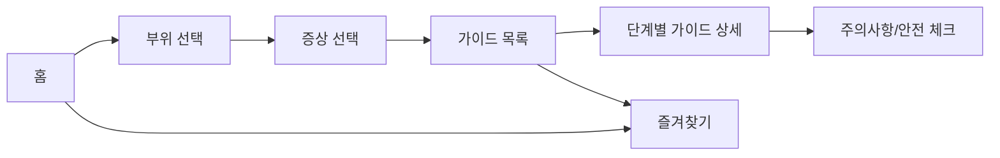

# 마산대학교 X ANCHOR 사업 — [STEP 1] 2026 마산대학교 해커톤 팀 아이디어 PRD

| 항목 | 내용 |
|---|---|
| 팀명 | 테이프핏 |
| 팀장 | 오준혁 |
| 팀원 (총 3명) | 오준혁, 장아영, 송수민 |
| 서비스명 | TapeFit (테이프핏) — 테이핑 가이드 앱 |

---

## 1. 문제 & 배경 (Problem)

**해결하고 싶은 문제**
- 운동·일상 중 발목, 무릎, 어깨, 손목 등을 다쳤을 때 테이핑이 도움이 되지만, 올바른 방법은 전문가(트레이너, 물리치료사)만 알고 있는 경우가 많습니다.
- 테이핑 정보가 유튜브, 블로그, 커뮤니티, 제품 설명서 등에 **흩어져 있고**, 출처와 신뢰도가 제각각이라 일반인이 정확한 방법을 찾기 어렵습니다.

**현재 사용자가 겪는 불편**
- 검색해도 영상이 길고, 부위·증상·테이프 종류별 정보가 섞여 있어 원하는 정보를 찾기 힘듭니다.
- 테이프 종류(키네시올로지 테이프, 리지드 테이프 등)와 당김 강도, 붙이는 방향·순서를 몰라 잘못 붙이면 효과가 없거나 피부 트러블·혈액순환 문제가 생길 수 있습니다.
- 운동 중이나 부상 직후에는 영상을 오래 볼 여유가 없고, 따라 하기 쉬운 단계별 안내가 부족합니다.

## 2. 타겟 사용자 (User)

**주요 사용자**
- 헬스, 러닝, 축구, 농구, 클라이밍 등 운동을 즐기는 대학생 및 20~30대 일반인
- 경미한 근육통·관절 불편을 겪는 직장인, 학생
- 전문 트레이너·치료사를 매번 찾아가기 어려운 사람

**사용자 특징**
- 스마트폰으로 정보를 찾는 데 익숙하며 짧고 직관적인 가이드를 선호
- 테이핑 경험이 적거나 없어 용어가 낯섦
- 비용·시간 때문에 즉각적이고 간편한 자기 관리 방법을 원함

## 3. 목표 & 가치 (Goal)

**제공 가치**
- 흩어진 테이핑 정보를 **한 곳에 통합**하여 검색 시간을 줄임
- 누구나 따라 할 수 있는 **단계별·시각적 가이드**로 올바른 테이핑 지원
- 부위·증상·테이프 종류에 맞는 맞춤 추천과 주의사항 제공으로 안전성 향상

**한 줄 요약**
> "전문가의 테이핑 노하우를, 누구나 쉽고 간편하게 — 부위만 고르면 바로 따라 하는 테이핑 가이드 앱"

## 4. 핵심 기능 (Features)

1. **부위·증상 기반 테이핑 가이드**
   - 인체 이미지에서 부위(발목, 무릎, 어깨, 손목, 허리 등) 선택 → 증상(염좌, 통증, 불안정감 등) 선택 → 맞는 테이핑 방법 제시
2. **단계별 따라하기 (3D 모델링 화면과 음성 가이드)**
   - 준비물, 테이프 길이·자르는 방법, 당김 강도(%), 붙이는 순서와 방향을 카드형 UI로 한 단계씩 안내
3. **안전 체크 & 주의사항**
   - 피부 알레르기, 붙이면 안 되는 경우, 통증이 심할 때 병원 방문 권고 등 사전 체크리스트 제공
4. (확장) 즐겨찾기, 테이프 종류 설명, 근처 정형외과/물리치료 안내

**차별점**
- 흩어진 정보를 정리·검수하여 통합한 단일 서비스 (영상 검색 → 앱 내 즉시 해결)
- 전문용어 없이 초보자 눈높이의 UI/UX

## 5. 개발 범위 & 계획 (Scope)

**구현 목표 (MVP)**
- 부위 선택 → 증상 선택 → 가이드 상세 흐름 완성
- 대표 부위 3~5곳(발목, 무릎, 손목, 어깨, 허리) 콘텐츠 탑재
- 안전 주의사항 화면, 즐겨찾기 기능
- 시연 가능한 동작 프로토타입

**사용 기술/도구 (예정)**
- 프론트엔드: Flutter 또는 React Native (모바일 앱, 안드로이드/iOS 동시 지원)
- 데이터: Firebase 또는 JSON 기반 로컬 콘텐츠 (MVP)
- AI 활용: github copilot,Codex를 활용한 코드 작성 및 개발 자동화
- 디자인: Figma / 협업: GitHub

**화면 흐름도 (초안)**

## 6. 기타 참고사항

- 제공 정보는 일반 참고용이며 의학적 진단·치료를 대체하지 않습니다. 증상이 심하면 전문가 진료를 권고합니다.
- 콘텐츠는 공신력 있는 자료와 전문가(물리치료사·트레이너) 자문으로 검증할 계획입니다.
- 추후 AI 기반 부위 인식, 맞춤 추천, 전문가 연결 서비스로 확장 가능합니다.
