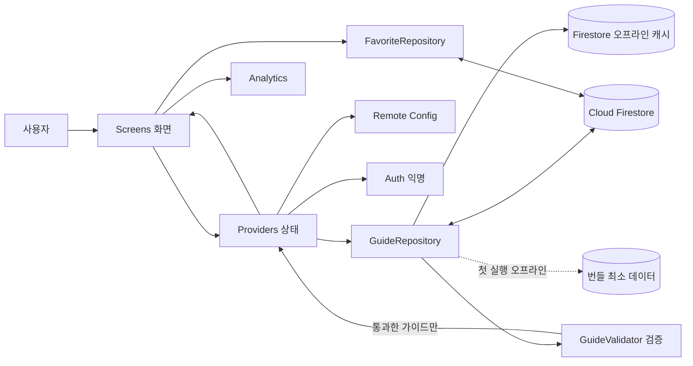
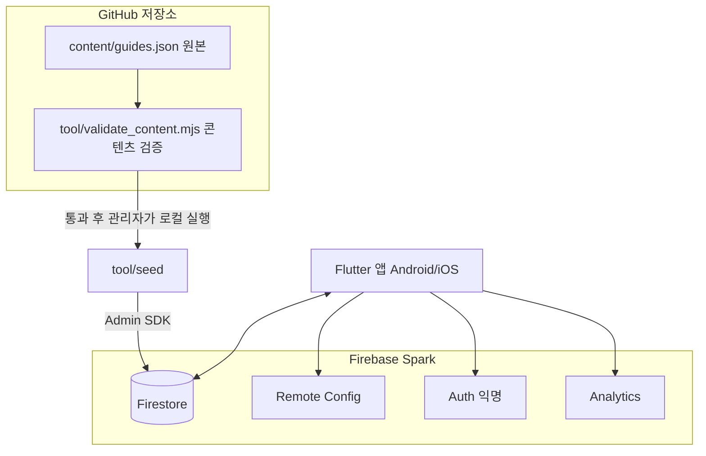
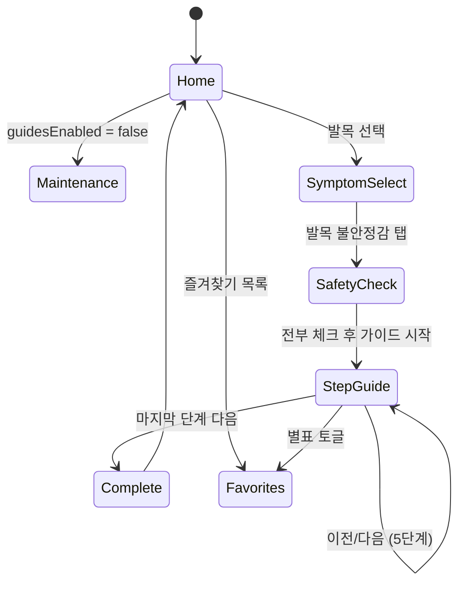
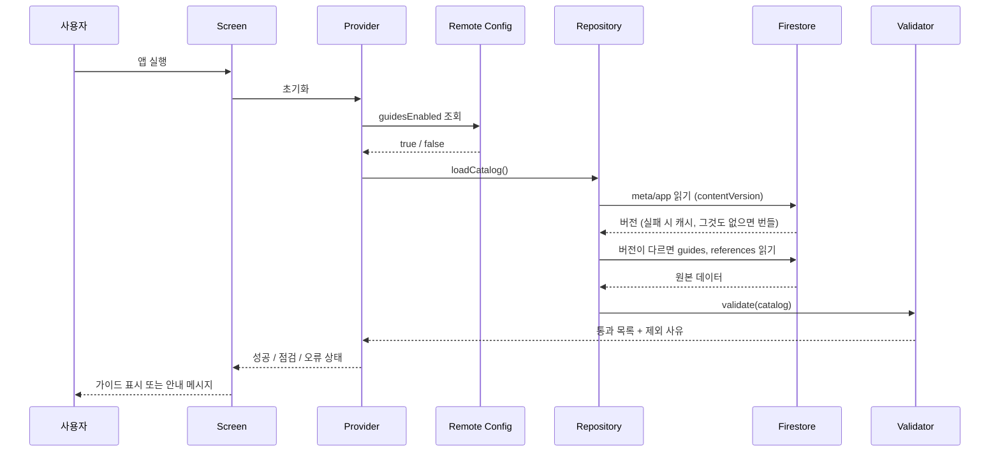

# TapeFit (테이프핏) — TRD (기술 요구사항 문서, Firebase 기반)

| 항목 | 내용 |
|---|---|
| 기준 문서 | `docs/PRD.md` (2026 마산대학교 해커톤, 팀 테이프핏) |
| 목적 | PRD의 MVP(발목 가이드)를 Firebase 무료 플랜 위에서 구현·검증하고, 부위·콘텐츠 확장이 가능한 구조를 정의한다 |
| 독자 | 심사위원(AI·사람), 개발팀(오준혁, 장아영, 송수민) |
| 상태 | 설계안(코드 미구현). 무료 플랜 한도·정책 수치는 도입 시점에 Firebase 공식 문서로 재확인한다 |
| PRD와의 차이 | 없음. 본 TRD는 **Firebase를 MVP부터 사용**하며, PRD 5장 "사용 기술"도 같은 내용으로 수정되어 있다. 결정·승인 기록은 1.4절 |

### 문서 지도

| 알고 싶은 것 | 위치 |
|---|---|
| 무엇을 만들고 무엇을 검증하나 (요구사항 ID) | 1장 |
| 기술 스택, Firebase 서비스 구성과 무료 플랜 선택 이유 | 2장 |
| 구성요소와 각자의 책임 | 3장 |
| 입력부터 결과까지의 흐름 | 4장 |
| 데이터 저장 구조 (Firestore) | 5장 |
| 화면·Firebase가 주고받는 형식(API) | 6장 |
| 문제 발생 시 동작과 안내 | 7장 |
| 요구사항 검증(테스트) | 8장 |
| 문제 → 요구사항 → 설계 → 구현 → 테스트 연결 | 9장 |
| 파일 구조 | 10장 |
| 구현 계획, 위험 | 11장 |

---

## 1. 요구사항과 범위

### 1.1 해결할 문제 (PRD 1장 인터뷰)

| 문제 | 근거 |
|---|---|
| 자료가 여러 가지라 어느 것이 맞는지 판단하기 어렵다 | 참가자 1·2 |
| 방법을 몰라 포기한다 | 참가자 2 |
| 붙인 뒤에도 제대로 붙였는지 불안하다 | 참가자 3 |

기술 목표: **출처와 검수 상태가 표시된 가이드 1가지를 단계별로 끝까지 따라 하게 하고, 근거가 확인되지 않은 내용은 화면에 내보내지 않는다.** 콘텐츠는 Firebase에서 내려받아 검수 결과를 앱 재배포 없이 반영한다.

### 1.2 범위

| 구분 | 내용 | 우선순위 |
|---|---|---|
| 핵심 | 발목 1개 부위·증상 1개, 증상 선택 → 안전 체크 → 5단계 가이드 → 완료. 콘텐츠는 Firestore에서 읽는다 | P0 |
| 안전 | Remote Config로 문제 콘텐츠를 즉시 숨기는 스위치 | P1 |
| 즐겨찾기 | 익명 로그인 + Firestore 저장 | P1 |
| 측정 | Analytics 이벤트로 PRD 성공 지표(완료율) 기록 | P1 |
| 해커톤 이후 | 부위 선택 화면, 무릎·손목·어깨·허리, 3D, 음성, 근처 병원 안내 | P2 |
| 제외 | 이메일·소셜 로그인, 사용자 정보 수집, 자체 서버, Cloud Functions, 진단 기능 | — |

### 1.3 요구사항 ID

| ID | 요구사항 | PRD 근거 |
|---|---|---|
| FR-01 | "발목 불안정감"을 누르면 안전 체크로 이동한다 | 5장 ① |
| FR-02 | 안전 체크 항목을 모두 체크해야 "가이드 시작"이 활성화된다 | 5장 ② |
| FR-03 | 5단계를 이전·다음으로 이동하며 단계마다 문구, 당김 강도, 출처, 테이프 그림을 표시한다 | 4-1, 5장 ③ |
| FR-04 | 마지막 단계 뒤 완료 화면에서 마무리 확인 사항을 안내하고 홈으로 돌아갈 수 있다 | 5장 ④ |
| FR-05 | (P1) ☆로 즐겨찾기를 저장하고, 앱을 다시 켜도 목록에서 다시 연다 | 5장 |
| FR-06 | 가이드마다 출처 목록과 검수 상태(검수 전 / 검수 완료 + 일자)를 표시한다 | 4장 차별점 |
| FR-07 | 면책 문구("진단·치료 대체 아님, 심하면 진료")를 가이드 화면에 항상 표시한다 | 6장 |
| FR-08 | 출처·검수 정보가 없거나, 단계가 계약(6.2절: 5단계, 1부터 연속·중복 없는 순서)에 맞지 않거나, 출처 참조가 끊어진 가이드는 화면에 노출하지 않는다 | 4장 콘텐츠 검수 기준 |
| FR-09 | 검수 전 항목은 보수적 문구와 "검수 전" 표시로 보여 준다 (호스슈 위치, "하루 이내 제거" 단정 금지) | 4-1 |
| FR-10 | (P1) 원격 스위치로 가이드 노출을 즉시 중단하고 점검 안내를 보여 준다 | 6장 안전 |
| FR-11 | (P1) 시작·안전 체크 통과·완료 이벤트를 기록해 완료율을 계산할 수 있다 | 5-1 성공 기준 |
| NFR-01 | 첫 실행 이후에는 네트워크 없이 전체 흐름이 동작한다. 첫 실행이 오프라인이어도 앱에 포함된 최소 데이터로 동작한다 | 본 TRD |
| NFR-02 | 캐시가 있을 때 첫 화면이 2초 이내 표시된다 | 본 TRD |
| NFR-03 | 운영비 0원이다 (Firebase Spark 무료 플랜 범위, 유료 결제 수단 등록 없음) | 본 TRD |
| NFR-04 | 이름·연락처·건강 상태 등 개인·건강정보를 수집하지 않는다. 식별자는 익명 UID뿐이다 | 본 TRD |
| NFR-05 | 콘텐츠를 Firestore 데이터만 바꿔 갱신하고, 부위 추가에 앱 코드 수정이 필요 없다 | 5장 중장기 |
| NFR-06 | 쓰기는 관리자 경로로만 가능하고, 앱은 가이드 데이터를 읽기만 한다 | 본 TRD |

### 1.4 PRD와의 차이와 결정 기록

| 항목 | PRD | 본 TRD | 상태 |
|---|---|---|---|
| 콘텐츠 저장 | 5장 "Firebase(Firestore, Spark 무료 플랜)에서 콘텐츠를 읽고, 앱에 포함한 JSON은 첫 실행 오프라인용 폴백으로만 사용" (PRD 수정 완료) | MVP부터 Firestore, 번들 JSON은 첫 실행 오프라인용 폴백만 | **PRD·TRD 범위 일치**. 결정자 승인 완료 (아래 승인 기록 참고) |

#### 승인 기록

| 항목 | 내용 |
|---|---|
| 결정 | 콘텐츠 저장을 로컬 JSON에서 Firebase(Firestore)로 변경, PRD 5장 "사용 기술"과 TRD를 같은 범위로 맞춤 |
| 결정자 | sumin1458 (저장소 소유자) |
| 결정일 | 2026-11-27 (PR #12 병합) |
| 근거 | GitHub PR #9(TRD 초안·개정), #11(번들 JSON 안 검토), #12(Firebase 안 복원) 이력 |
| 승인 방식 | 저장소 관리와 PR 병합은 결정자 1인이 맡고, 팀원은 GitHub를 쓰지 않으므로 PR 승인 기록 대신 위 결정 이력을 근거로 한다 |

---

## 2. 기술 스택과 Firebase 구성

### 2.1 스택

| 구분 | 결정 | 이유 |
|---|---|---|
| 클라이언트 | Flutter | PRD 확정. Android/iOS 단일 코드베이스, 웹 빌드도 가능 |
| 상태관리·라우팅 | Riverpod, go_router | 테스트가 쉽고 화면 ①~④ 흐름과 대응 |
| 백엔드 | **Firebase Spark(무료) 플랜** | Flutter 공식 SDK(FlutterFire), 카드 등록 불필요, 서버 코드 없이 DB·인증·원격 설정을 한 곳에서 제공 |
| 협업 | GitHub | PRD 확정 |

### 2.2 Firebase 서비스별 역할

| 서비스 | 용도 | 우선순위 | 비고 |
|---|---|---|---|
| **Cloud Firestore** | 가이드·출처·공통 문구 저장과 읽기, 즐겨찾기 저장 | P0 | 모바일은 오프라인 캐시가 기본 제공된다 (웹은 별도 설정 필요) |
| **Remote Config** | `guidesEnabled`(노출 스위치), `minContentVersion` | P1 | FR-10 |
| **Authentication (익명)** | 즐겨찾기를 기기별로 분리·복원하기 위한 익명 UID | P1 | 이메일·전화번호 수집 없음 |
| **Analytics** | 완료율 계산용 이벤트 | P1 | 개인정보 미포함 |
| Crashlytics | 앱 오류 수집 | 선택 | 시간 여유 시 |
| 사용하지 않음 | Cloud Functions, Cloud Storage | — | 이 두 서비스는 무료 플랜 제약이 있을 수 있어 제외. 그림은 JSON 좌표로 그린다 |

### 2.3 호스팅·DB 비교와 선택 이유

서비스 특성: **읽기 위주**, 데이터가 작고(가이드 수십 건 이하), 쓰기는 즐겨찾기뿐이며, 팀 3명이 2일 안에 만든다.

| 후보 | 장점 | 단점 | 판단 |
|---|---|---|---|
| **Firebase Spark** | Flutter 1급 지원, 모바일 오프라인 캐시 내장, 설정이 빠르고 규칙으로 보안을 선언, 원격 설정까지 통합 | NoSQL(본 서비스는 조인이 필요 없어 무관), 벤더 종속 | **채택** |
| Supabase(무료) | SQL, 오픈소스 | 무료 프로젝트가 비활성 시 일시중지될 수 있어 시연 중 장애 위험, 오프라인 캐시는 직접 구현 | 차선 |
| Cloudflare Pages + D1 | 빠른 CDN | 모바일 SDK 없음, API를 직접 구현해야 함 | 웹 전용일 때만 |
| Vercel/Netlify + 외부 DB | 웹 배포가 쉽다 | DB를 따로 붙여야 하고 모바일 앱에 이점이 적다 | 비추천 |

### 2.4 무료 플랜 안에서 운영하기 위한 설계 (NFR-03)

| 항목 | 설계 |
|---|---|
| 읽기 횟수 | 시작 시 `meta/app` 문서 1건만 먼저 읽어 `contentVersion`이 캐시와 같으면 나머지는 캐시를 사용한다. 가이드 1건은 문서 1개에 내장해 한 번에 읽는다 |
| 쓰기 횟수 | 앱의 쓰기는 즐겨찾기 토글뿐이다 |
| 저장 용량 | 가이드는 문서당 수 KB로 무료 저장 한도에 한참 못 미친다 |
| 과금 방지 | Blaze 플랜으로 올리지 않고 결제 수단을 등록하지 않는다. Firebase 콘솔의 사용량 알림을 켠다 |
| Firestore 무료 한도 (공식 문서 확인) | 저장 1 GiB, 문서 읽기 하루 50,000건, 쓰기 하루 20,000건, 삭제 하루 20,000건, 외부 전송 월 10 GiB. 한도는 매일 태평양 시간 자정쯤 초기화되고, 무료 데이터베이스는 프로젝트당 1개다. 문서 1개 최대 크기는 1 MiB다. 출처: https://firebase.google.com/docs/firestore/quotas , 확인일 2026-11-27 |
| 한도 대비 사용 예상 | 앱 1회 실행의 읽기는 `meta/app` 1건(버전이 같을 때) 또는 가이드·부위·출처 문서 수 건이므로, 사용자 수십 명이 하루 수십 번 써도 하루 읽기 50,000건에 한참 못 미친다. 실제 사용량은 T-22로 확인한다 |
| 요금제 정책 (공식 문서 확인) | Spark는 결제 정보 없이 쓸 수 있고, 인증(대부분의 방식)·Crashlytics 등은 사용자 수와 관계없이 무료다. Firestore·Remote Config 등은 무료 사용 할당량이 있고, **월 단위 무료 한도를 넘기면 그 제품은 그 달 남은 기간 동안 차단**된다. 결제 계정을 연결하면 Blaze로 자동 전환되므로 연결하지 않는다. 출처: https://firebase.google.com/docs/projects/billing/firebase-pricing-plans , 확인일 2026-11-27 |
| 아직 확인하지 못한 것 | Remote Config의 구체적 수치 한도, 익명 로그인이 "대부분의 방식"에 포함되는지, Analytics 이벤트 한도. 도입 시점에 해당 제품 문서에서 확인하고 11.1절 설정 기록에 적는다 |

---

## 3. 시스템 구조

### 3.1 구성요소와 책임



| 구성요소 | 책임 | 하지 않는 일 |
|---|---|---|
| Screens | 탭 입력 수신, 상태 렌더링, 화면 이동, 이벤트 호출 | 데이터 로딩, 검증 |
| Providers | 증상·단계·안전 체크 상태 관리, 로딩/성공/오류 상태 결정, 원격 스위치 반영 | Firebase 세부 호출 |
| GuideRepository | Firestore(캐시 우선) 조회, 실패 시 번들 폴백, 파싱 | UI 로직 |
| GuideValidator | 필수 필드·출처 참조·검수 상태 검증, 부적합 가이드 제거 | 콘텐츠 수정 |
| FavoriteRepository | 익명 UID 하위 즐겨찾기 읽기·쓰기, 없는 ID 정리 | 가이드 조회 |
| AuthService | 익명 로그인, UID 제공 | 사용자 정보 수집 |
| ConfigService | Remote Config 값 조회, 실패 시 기본값 사용 | 콘텐츠 본문 제공 |
| AnalyticsService | 정해진 이벤트만 전송 | 개인정보 전송 |
| TapeDiagram | `tape` 좌표를 `CustomPainter`로 그림 | 문구 표시 |
| 콘텐츠 관리 도구 (`tool/seed`) | 검증된 JSON을 Firestore에 업로드 (관리자 권한) | 앱 실행 중 동작 |

### 3.2 배포 구조



콘텐츠의 **원본은 Git의 JSON**이고 Firestore는 배포 대상이다. 검수 결과는 JSON을 수정해 PR로 검토한 뒤 업로드하므로 이력이 남고, Firebase를 다시 만들어도 복원할 수 있다.

### 3.3 화면 상태 전이



---

## 4. 데이터 흐름

입력 → 설정 확인 → 로드 → 검증 → 상태 반영 → 안전 체크 → 표시 → 기록 → 보관 순서로 이동한다.

| 순서 | 단계 | 내용 | 담당 |
|---|---|---|---|
| 1 | 입력 | 앱 실행 | Screens |
| 2 | 설정 확인 | Remote Config에서 `guidesEnabled`, `minContentVersion` 확인. 실패 시 4.1절 정책을 따른다 (기본값 `true`로 열지 않는다) | ConfigService |
| 3 | 로드 | `meta/app`의 `contentVersion`을 확인하고, 같으면 캐시를, 다르면 서버에서 `bodyParts`, `guides`, `references`를 읽는다. 실패하면 캐시 → 번들 순 폴백 | GuideRepository |
| 4 | 검증 | 증상마다 `sources`, `review`, `steps`, `cautions` 확인. 부적합 증상은 제외하고 사유를 기록 | GuideValidator |
| 5 | 상태 반영 | 통과 데이터를 로딩/성공/오류 상태로 노출 | Providers |
| 6 | 안전 체크 | `cautions`를 전부 체크해야 "가이드 시작" 활성화 | Providers, Screens |
| 7 | 표시 | 단계 문구, 당김 강도, 출처, 검수 상태, 면책 문구, 테이프 그림 | Screens |
| 8 | 기록 | `guide_start`, `safety_pass`, `guide_complete` 이벤트 전송 | AnalyticsService |
| 9 | 보관 | 별표 토글 시 `users/{uid}/favorites/{symptomId}` 저장 | FavoriteRepository |



### 4.1 콘텐츠 버전과 설정 실패 정책 (안전하게 실패)

**버전 형식과 비교**: `contentVersion`, `minContentVersion`은 `연.월.일련번호`(예: `2026.11.1`) 형식이다. 점(`.`)으로 나눈 세 정수를 **앞 칸부터 숫자로** 비교한다 (`2026.11.10` > `2026.11.2`). 형식이 틀리면 해당 값은 사용할 수 없는 값으로 보고 그 콘텐츠를 거부한다. 비교 대상은 "앱 빌드"가 아니라 **화면에 쓰려는 콘텐츠 본체**의 `contentVersion`이다.

**사용할 콘텐츠 선택**: 원격·캐시·번들 후보 중 (1) 검증을 통과하고 (2) `minContentVersion` 이상인 것만 후보로 두고, 그중 버전이 가장 높은 것을 쓴다. 후보가 없으면 점검 화면을 보여 준다. 번들은 빌드 시점에 검증·고정된 버전이다.

| 상황 | 동작 |
|---|---|
| `guidesEnabled` 조회 성공 | 그 값을 저장하고 사용 |
| 조회 실패, 마지막 성공 값이 24시간 이내 | 마지막 성공 값 사용 |
| 조회 실패, 마지막 성공 값이 `false` | 만료와 관계없이 `false` 유지 (조회에 성공해 `true`를 받을 때까지 차단) |
| 조회 실패, 값이 없거나 24시간 초과(마지막 값이 `true`) | "상태 미확인". **번들 콘텐츠만** 허용하고 서버·캐시의 더 새로운 콘텐츠는 쓰지 않는다. "최신 상태를 확인하지 못했어요" 안내를 표시 |
| 캐시 콘텐츠가 `minContentVersion` 미만 | 캐시를 버리고 서버를 다시 읽는다. 오프라인이면 번들이 기준을 충족할 때만 번들, 아니면 점검 화면 |
| 캐시 콘텐츠 자체의 나이 | 만료로 막지 않는다 (검수된 문구는 시간이 지나도 유효). 마지막 서버 확인이 7일을 넘으면 "마지막 확인: N일 전"을 표시 |

**앱 시작 초기화 순서 (의사코드)**

```text
main():
  1. Firebase.initializeApp()                 // 실패해도 앱은 계속 (번들로 동작)
  2. 인증: 익명 로그인 시도                    // 실패해도 가이드는 열람 가능, 즐겨찾기만 비활성
  3. config = RemoteConfig.fetch(타임아웃 3초)   // 실패 시 마지막 저장값 사용 (위 표)
  4. if config.guidesEnabled == false: → 점검 화면, 종료
  5. candidates = [서버 meta/app+guides, 캐시, 번들]  // 서버는 온라인일 때만
  6. 각 후보를 GuideValidator로 검증하고 minContentVersion 이상만 남김
  7. 가장 높은 버전 선택. 없으면 점검 화면
  8. 홈(증상 목록) 표시
```

**연결 상태 × 설정 조회 결과별 기대 화면** (첫 실행 = 캐시 없음)

| 연결 | 설정 조회 | 캐시 | 기대 동작 |
|---|---|---|---|
| 온라인 | 성공, 켜짐 | 있음/없음 | 서버(또는 캐시) 콘텐츠로 홈 표시 |
| 온라인 | 성공, 꺼짐 | 무관 | 점검 화면 |
| 온라인 | 실패, 마지막 값 24시간 이내 | 무관 | 마지막 값에 따름 (꺼짐이면 점검 화면) |
| 온라인 | 실패, 값 없음/만료 | 무관 | 번들 콘텐츠로 홈 + "최신 상태를 확인하지 못했어요" |
| 오프라인 | 실패 | 있음, 버전 충족 | 마지막 값 24시간 이내면 캐시, 아니면 번들 |
| 오프라인 | 실패 | 없음 (**첫 실행**) | 번들 콘텐츠로 홈 + 확인 불가 안내 |
| 오프라인 | 실패 | 있음, 버전 미달 | 번들이 기준 충족이면 번들, 아니면 점검 화면 |

이 정책은 "근거가 확인되지 않은 내용을 내보내지 않는다"는 원칙에 맞춰, 판단 근거가 없을 때 **가장 보수적인(빌드 시 검증된) 콘텐츠로 후퇴**하거나 차단한다.

---

## 5. 데이터 저장 구조 (Firestore)

### 5.1 컬렉션 구조

```
meta/app                         공통 정보 (단일 문서)
  contentVersion: "2026.11.1"
  disclaimer: "일반 참고용입니다. ..."
  schemaVersion: 1
bodyParts/{bodyPartId}           ankle, knee, wrist, shoulder, back
  name, available, order
guides/{symptomId}               증상 1건 = 문서 1개 (steps, cautions는 배열로 내장)
  bodyPartId, name, tape, tapeNeeded, sources[], published
  review { status, reviewer, reviewedAt }
  steps[ { order, title, body, tension, sources[], tape[][][] } ]
  cautions[ { text, sources[] } ]
references/{sourceId}            S1 ~ S6
  type, title, url
users/{uid}/favorites/{symptomId}  즐겨찾기 (uid는 익명 로그인 UID)
  createdAt
```

설계 이유:

| 결정 | 이유 |
|---|---|
| 가이드 1건을 문서 1개에 내장 | 한 번의 읽기로 전체를 로드해 무료 읽기 한도를 아끼고, 문서 크기 한도(약 1MiB)에 한참 못 미친다 |
| `guides`에 `bodyPartId` 보유 | 부위 추가 시 문서만 추가하면 된다 (NFR-05) |
| `published` 필드 | 검수 중 콘텐츠를 앱에 노출하지 않고 준비할 수 있다 |
| `references`를 별도 컬렉션 | 출처 상세를 한 곳에서 관리하고 단계·주의사항에서 ID로 참조한다 |
| 즐겨찾기를 `users/{uid}` 하위로 | 보안 규칙을 UID 단위로 단순하게 걸 수 있다 |
| `tape` 좌표 | PRD 6-1 `guides.json`의 좌표와 같은 형식을 유지해 그림을 앱에서 그린다 |

PRD 6-1 샘플 대비 변경점: `source` 문자열 → `sources` ID 배열과 `references` 컬렉션, `review` 객체, 단계·주의사항별 출처, `published`, 버전 필드.

### 5.2 문서 예시 (`guides/ankle_instability`)

```jsonc
{
  "bodyPartId": "ankle",
  "name": "발목 불안정감 (가벼운 염좌 후)",
  "tape": "리지드 테이프 + 언더랩",
  "tapeNeeded": "리지드 테이프, 언더랩, 가위",
  "sources": ["S3", "S5", "S6"],
  "published": true,
  "review": { "status": "pending", "reviewer": "송수민", "reviewedAt": null },
  "steps": [
    { "order": 1, "title": "피부 준비",
      "body": "땀과 오염을 씻고 말리세요. 체모는 제거하고, 상처는 거즈로 덮으세요. 붙이는 동안 움직이지 마세요.",
      "tension": "없음", "sources": ["S3"], "tape": [] },
    { "order": 2, "title": "앵커",
      "body": "종아리 근육 바로 아래쪽에 테이프를 2~3줄 둘러 시작점을 고정하세요.",
      "tension": "당기지 않음", "sources": ["S3", "S5"],
      "tape": [[[80, 96], [130, 96]]] },
    { "order": 3, "title": "스터럽",
      "body": "발 안쪽에서 발뒤꿈치 아래를 지나 바깥쪽으로 U자로 붙여 인대를 지지하세요. 총 3줄을 붙입니다.",
      "tension": "약하게", "sources": ["S3", "S5"],
      "tape": [[[82, 96], [82, 150], [86, 190], [105, 206], [124, 190], [128, 150], [128, 96]]] },
    { "order": 4, "title": "호스슈",
      "body": "스터럽을 고정하는 용도로 말발굽 모양으로 붙여 발목이 좌우로 흔들리지 않게 하세요. (붙이는 위치는 송수민 검수 예정)",
      "tension": "약하게", "sources": ["S3"],
      "tape": [[[128, 150], [112, 178], [96, 186], [82, 160]]] },
    { "order": 5, "title": "마무리 확인",
      "body": "앤드로 끝맺고, 조이거나 아프면 떼고 다시 붙이세요. 피부가 창백하거나 테이프가 파고들면 너무 강한 것입니다.",
      "tension": "당기지 않음", "sources": ["S3"],
      "tape": [[[80, 90], [130, 90]], [[80, 102], [130, 102]]] }
  ],
  "cautions": [
    { "text": "조이거나 아프면 다시 붙이고, 붙인 테이프 위에 덧붙이지 말고, 구김 없이 붙이세요.", "sources": ["S3"] },
    { "text": "골절·탈구가 의심되면 테이핑만 믿고 움직이지 마세요.", "sources": ["S3"] },
    { "text": "붓기·멍이 심하거나 체중을 실을 수 없으면 테이핑 전에 전문의 진료를 받으세요.", "sources": ["S6"] }
  ]
}
```

위 예시는 5단계 전체이며 주의사항은 지면상 3건만 싣는다 (전체 6건은 `content/guides.json`). 이 예시의 단계 5개가 6.2절 규칙을 모두 통과해야 하며, 이를 T-01·T-25가 검증한다.

### 5.3 도메인 모델 (Dart)

| 모델 | 필드 |
|---|---|
| `GuideCatalog` | `contentVersion`, `disclaimer`, `bodyParts`, `references`, `excluded`(제외된 증상과 사유) |
| `BodyPart` | `id`, `name`, `available`, `symptoms` |
| `Symptom` | `id`, `name`, `tape`, `tapeNeeded`, `sources`, `review`, `steps`, `cautions` |
| `TapeStep` | `order`, `title`, `body`, `tension`, `sources`, `tape` |
| `Caution` | `text`, `sources` |
| `Review` | `status`(pending / verified), `reviewer`, `reviewedAt` |
| `Reference` | `id`, `type`, `title`, `url` |

### 5.4 보안 규칙

원칙: 가이드 데이터는 **누구나 읽기만** 가능하고, 쓰기는 관리자(Admin SDK, 규칙을 우회함)만 한다. 즐겨찾기는 **본인 UID 경로만** 읽고 쓴다.

```
rules_version = '2';
service cloud.firestore {
  match /databases/{db}/documents {
    match /meta/{id}       { allow read: if true; allow write: if false; }
    match /bodyParts/{id}  { allow read: if true; allow write: if false; }
    match /references/{id} { allow read: if true; allow write: if false; }
    match /guides/{id} {
      allow read: if resource.data.published == true;
      allow write: if false;
    }
    match /users/{uid}/favorites/{symptomId} {
      allow read, delete: if request.auth != null && request.auth.uid == uid;
      allow create, update: if request.auth != null && request.auth.uid == uid
        && symptomId.matches('^[a-z0-9_]{1,64}$')
        && request.resource.data.keys().hasOnly(['createdAt'])
        && request.resource.data.createdAt == request.time;
    }
  }
}
```

즐겨찾기 payload는 필드 이름뿐 아니라 **값 형식**도 검사한다: 문서 ID는 소문자·숫자·밑줄 64자 이내, `createdAt`은 서버 시각(`FieldValue.serverTimestamp()`)이어야 한다. 앱이 서버 타임스탬프로만 쓰므로 정상 동작에는 영향이 없다.

**조회와 규칙의 호환**: 규칙은 문서의 `published == true`를 요구하므로, 목록 조회는 규칙을 만족하는 쿼리여야 한다. Repository는 가이드를 **`collection('guides').where('published', isEqualTo: true)`로만 조회**한다 (조건 없는 전체 조회는 거부되므로 사용하지 않는다). 이는 T-15·T-10b로 검증한다.

### 5.5 오프라인 정책

| 상황 | 동작 |
|---|---|
| 모바일 | Firestore 오프라인 캐시를 사용한다. 한 번 읽은 가이드는 오프라인에서도 열린다 |
| 웹 | 영속 캐시를 명시적으로 켠다. 지원되지 않는 브라우저는 번들 폴백을 쓴다 |
| 첫 실행이 오프라인 | 앱에 포함한 최소 데이터(`assets/fallback/guides.json`, 발목 가이드 1건)로 동작한다. 이 데이터는 업로드 전에 Git 원본에서 복사한다 |
| 오래된 캐시·설정 조회 실패 | 4.1절 정책을 따른다 (버전 비교, 번들로 후퇴, 점검 화면) |
| 즐겨찾기 오프라인 | 로컬에 쌓았다가 온라인이 되면 Firestore가 동기화한다 |

---

## 6. 인터페이스(API) 계약

서버 코드를 만들지 않으므로 **화면 ↔ Repository 계약**과 **Repository ↔ Firebase 문서 규칙**을 약속으로 고정한다.

### 6.1 Repository 계약 (Dart)

| 메서드 | 입력 | 응답 | 실패 시 |
|---|---|---|---|
| `Future<GuideCatalog> loadCatalog()` | 없음 | 검증 통과분과 제외 사유를 담은 `GuideCatalog` | 캐시 → 번들 폴백 후에도 실패하면 `GuideLoadException(code, message)` |
| `Future<Symptom> getSymptom(String id)` | 증상 ID | `Symptom` | `GuideNotFoundException` |
| `Stream<Set<String>> watchFavorites()` | 없음 | 즐겨찾기 증상 ID 집합 | 빈 집합 |
| `Future<void> toggleFavorite(String id)` | 증상 ID | 없음 | `StorageException` |
| `Future<AppConfig> getConfig()` | 없음 | `AppConfig{ guidesEnabled, minContentVersion, fetchedAt, isStale }` | 4.1절 정책 (24시간 내 마지막 성공 값, 마지막 값이 `false`면 유지, 그 외는 "상태 미확인"=번들만 허용) |
| `void logEvent(AppEvent e)` | 이벤트 | 없음 | 무시 (기능에 영향 없음) |

### 6.2 문서 필드 규칙 (검증 기준)

| 객체 | 필수 | 조건 |
|---|---|---|
| Symptom(`guides/{id}`) | `bodyPartId`, `name`, `tape`, `tapeNeeded`, `sources`(1개 이상, 중복 없음), `published`, `review.status`, `steps`, `cautions`(1개 이상) | `bodyPartId`는 `bodyParts`에 존재. `review.status=verified`이면 `reviewedAt` 필수 |
| steps 배열 | 발목 MVP는 **정확히 5개** (피부 준비 → 앵커 → 스터럽 → 호스슈 → 마무리 확인) | `order`는 1부터 N까지 **연속·중복 없음**. 배열 순서가 달라도 앱은 `order`로 정렬하되, 누락·중복·0 이하는 증상 전체를 제외한다. 단계 수는 증상별 `expectedSteps`(콘텐츠 검증 스크립트의 설정)와 일치해야 한다 |
| TapeStep | `order`, `title`, `body`, `tension`, `sources`(1개 이상) | `tape`는 선택. 있으면 각 줄은 점 2개 이상, 점은 `[x, y]` 숫자 쌍이며 **x 0~210, y 0~230 범위**. 위반 시 그림만 생략(7장) |
| Reference | `type`, `title` | `url`은 선택 |
| 참조 무결성 | 모든 `sources`(증상·단계·주의사항)의 ID는 `references`에 존재 | 위반 시 해당 증상 제외 (FR-08) |
| 버전 | `meta/app.contentVersion`, Remote Config `minContentVersion` | `연.월.일련번호` 형식, 비교는 4.1절 |
| Remote Config | `guidesEnabled`(bool), `minContentVersion`(string) | 콘텐츠 버전이 더 낮으면 점검 안내 |

같은 규칙을 **세 곳**에서 확인한다: 콘텐츠 업로드 전 검증 스크립트(`tool/validate_content.mjs`, 업로드 스크립트가 먼저 실행), 앱의 `GuideValidator`, 보안 규칙(쓰기 차단·미게시 차단). 앞의 둘은 데이터 품질, 마지막은 접근 제어를 맡는다. **스크립트와 Validator가 같은 규칙을 다르게 구현하지 않도록**, 잘못된 데이터 사례(`test/fixtures/invalid_cases.json`: 출처 누락, 끊어진 참조, 단계 중복·누락·순서 오류, 좌표 범위 밖, 잘못된 버전 형식)를 두 구현이 **모두 거부**하는지 같은 파일로 테스트한다 (T-25).

#### 6.2.1 필드 타입·길이·허용값

길이는 문자 수이며, 현재 콘텐츠 최대값에 여유를 둔 상한이다. 상한을 넘으면 `FIELD_LENGTH` 오류로 증상을 제외한다 (검증 스크립트와 Validator가 같은 상한을 쓴다).

| 필드 | 타입 | 길이·범위 | 허용값 |
|---|---|---|---|
| `guides/{id}` 문서 ID | string | 1~64 | 소문자·숫자·밑줄 (`^[a-z0-9_]{1,64}$`) |
| `bodyPartId` | string | 1~32 | `bodyParts` 문서 ID와 일치 |
| `name` | string | 1~60 | 공백만 있는 값 금지 |
| `tape`, `tapeNeeded` | string | 1~60 | 공백만 있는 값 금지 |
| `sources` (증상·단계) | string 배열 | 1~10개 | `references` 문서 ID (`^S[0-9]+$`), 중복 금지 |
| `cautions` | 객체 배열 | **1~10개** (6.2절과 동일, 0개면 `CAUTION_MISSING`) | 항목은 `text`와 `sources` |
| `cautions[].sources` | string 배열 | 0~10개 (주의사항 항목 하나가 가진 출처 수. 출처 없는 주의사항 허용) | `references` 문서 ID, 중복 금지 |
| `published` | bool | — | `true`/`false` |
| `review.status` | string | — | `pending`, `verified` |
| `review.reviewer` | string | 1~30 | — |
| `review.reviewedAt` | string 또는 null | `YYYY-MM-DD` | `verified`이면 필수, `pending`이면 null 허용 |
| `steps` | 객체 배열 | 발목은 정확히 5개 | 6.2절 표 |
| `steps[].order` | int | 1~5 | 1부터 연속, 중복 금지 |
| `steps[].title` | string | 1~20 | — |
| `steps[].body` | string | 1~200 | — |
| `steps[].tension` | string | — | `없음`, `당기지 않음`, `약하게` |
| `steps[].tape` | `[[ [x, y] ... ] ...]` | 줄당 점 2개 이상, 단계당 줄 0~10개 | x는 0~210, y는 0~230의 숫자 |
| `cautions[].text` | string | 1~120 | — |
| `references[].type` | string | — | `학술`, `의료기관`, `교육 자료`, `콘텐츠 검수` |
| `references[].title` | string | 1~200 | — |
| `references[].url` | string 또는 없음 | 최대 500 | `https://`로 시작 |
| `meta/app.contentVersion` | string | — | `^\d+\.\d+\.\d+$` |
| `meta/app.disclaimer` | string | 1~200 | — |

#### 6.2.2 오류 코드 매핑

Validator는 위반마다 아래 코드와 위치(증상 ID, 단계 번호)를 `excluded` 목록에 남긴다. 검증 스크립트는 같은 코드를 출력하고 업로드를 중단한다. 화면에는 코드를 보이지 않고 7장의 안내 문구만 보인다.

| 코드 | 위반 | 처리 | 사용자 안내(7장) |
|---|---|---|---|
| `SOURCE_MISSING` | 증상·단계의 `sources`가 비어 있음 | 증상 제외 | (표시 없음) |
| `SOURCE_DUPLICATE` | `sources`에 같은 ID가 두 번 있음 | 증상 제외 | (표시 없음) |
| `REF_BROKEN` | `sources`의 ID가 `references`에 없음 | 증상 제외 | (표시 없음) |
| `REVIEW_INVALID` | `review.status`가 허용값이 아님 | 증상 제외 | (표시 없음) |
| `REVIEW_DATE_MISSING` | `verified`인데 `reviewedAt`이 없음 | 증상 제외 | (표시 없음) |
| `STEP_COUNT` | 단계 수가 `expectedSteps`와 다름 | 증상 제외 | (표시 없음) |
| `STEP_ORDER` | `order`가 1부터 연속이 아니거나 중복·0 이하 | 증상 제외 | (표시 없음) |
| `FIELD_EMPTY` | 이름·제목·본문·당김 강도·주의사항 문구가 비어 있음 | 증상 제외 | (표시 없음) |
| `FIELD_LENGTH` | 6.2.1의 길이 상한 초과 | 증상 제외 | (표시 없음) |
| `ENUM_INVALID` | `tension`, `type` 등이 허용값이 아님 | 증상 제외 | (표시 없음) |
| `CAUTION_MISSING` | `cautions`가 비어 있음 | 증상 제외 | (표시 없음) |
| `TAPE_RANGE` | 좌표가 범위 밖이거나 줄당 점이 2개 미만 | 그림만 생략 | "그림을 표시할 수 없어요." |
| `VERSION_FORMAT` | `contentVersion`·`minContentVersion` 형식 오류 | 해당 콘텐츠 거부(4.1절) | "현재 가이드를 점검 중입니다." |
| `NO_GUIDES` | 제외 후 남은 증상이 없음 | 빈 화면 대신 안내 | "현재 제공 가능한 가이드가 없습니다." |
| `LOAD_FAILED` | 원격·캐시·번들 모두 실패 (`GuideLoadException`) | 재시도 버튼 | "가이드를 불러오지 못했어요. 다시 시도해 주세요." |
| `GUIDE_NOT_FOUND` | 없는 증상 ID (`GuideNotFoundException`) | 홈으로 이동 | "찾을 수 없는 가이드입니다." |
| `FAVORITE_FAILED` | 즐겨찾기 저장 실패 (`StorageException`) | 상태 되돌림 | "즐겨찾기를 저장하지 못했어요." |

2026-11-27 기준 `lib/core/validation.dart`와 `tool/validate_content.mjs`는 위 코드 중 검증 규칙에 해당하는 13개(`SOURCE_*`, `REF_BROKEN`, `REVIEW_*`, `STEP_*`, `FIELD_*`, `ENUM_INVALID`, `CAUTION_MISSING`, `TAPE_RANGE`, `VERSION_FORMAT`)를 `코드: 위치` 형식으로 출력한다. 존재하지 않는 `bodyPartId`는 `REF_BROKEN`, `reviewedAt` 형식 오류(`YYYY-MM-DD` 아님)는 `REVIEW_DATE_MISSING`으로 처리한다. 앱 런타임 코드(`NO_GUIDES`, `LOAD_FAILED`, `GUIDE_NOT_FOUND`, `FAVORITE_FAILED`)는 아직 미구현이다. `TAPE_RANGE`는 앱의 증상 제외 판단(`validateCatalog`)에서 빠지고 그림만 생략한다.

#### 6.2.3 예시 데이터 검증 기록

5.2절의 문서 예시와 `content/guides.json`이 위 규칙을 통과하는지는 T-01과 T-25로 검증하며, 결과는 8.1절에 날짜·환경과 함께 기록한다. 실행 전에는 통과로 간주하지 않는다.

### 6.3 Analytics 이벤트 약속 (FR-11)

| 이벤트 | 시점 | 파라미터 |
|---|---|---|
| `guide_start` | 안전 체크 통과 후 "가이드 시작" | `symptom_id` |
| `safety_pass` | 안전 체크 전부 체크 | `symptom_id` |
| `step_view` | 단계 화면 표시 | `symptom_id`, `step_order` |
| `guide_complete` | 완료 화면 도달 | `symptom_id` |
| `favorite_toggle` | 별표 토글 | `symptom_id`, `on` |

파라미터에는 증상 ID와 단계 번호만 넣고 개인정보는 넣지 않는다. 완료율 = `guide_complete` ÷ `guide_start`이며, PRD의 직접 관찰 테스트를 대체하지 않고 보조한다.

**중복 방지**: `guide_start`·`safety_pass`·`guide_complete`는 가이드 진행 1회(시작~완료)에 **최대 1번**만 보낸다. 앱 메모리의 진행 플래그로 판단하며(저장·식별자 없음), 완료 화면 재진입·뒤로 가기·화면 회전으로 다시 그려져도 재전송하지 않는다. 새로 시작하면 플래그를 초기화한다. 완료율 분모(`guide_start`)도 같은 방식이라 100%를 넘지 않는다 (T-29).

---

## 7. 오류 처리

원칙: 오류가 나도 **잘못된 의료 안내가 노출되지 않는 방향(차단·제외)** 으로 실패하고, 앱은 종료되지 않는다.

| 상황 | 동작 | 사용자 안내 |
|---|---|---|
| 서버 읽기 실패 | 캐시 → 번들 순으로 폴백 | "오프라인 데이터로 표시 중입니다." |
| 서버·캐시·번들 모두 실패 | 로딩 중단, 재시도 버튼 | "가이드를 불러오지 못했어요. 다시 시도해 주세요." |
| 출처·검수 필드 누락 증상 | 해당 증상만 제외, 사유 기록 | (표시 없음) |
| 제외 후 남은 증상 없음 | 빈 화면 대신 안내 | "현재 제공 가능한 가이드가 없습니다." |
| `guidesEnabled=false` 또는 사용할 수 있는 콘텐츠 버전이 `minContentVersion`보다 낮음 | 가이드 진입 차단 | "현재 가이드를 점검 중입니다." |
| Remote Config 조회 실패 | 4.1절: 24시간 내 마지막 값 사용, 마지막 값이 `false`면 차단 유지, 그 외 "상태 미확인"이면 번들 콘텐츠만 허용 | "최신 상태를 확인하지 못했어요." (상태 미확인일 때만) |
| 단계 수·순서 위반(누락·중복·역순) | 해당 증상 전체 제외 | (표시 없음) |
| 안전 체크 미완료 | 시작 버튼 비활성, 미체크 항목 강조 | "모든 주의사항을 확인해 주세요." |
| 없는 증상 ID / 잘못된 경로 | 홈으로 이동 | "찾을 수 없는 가이드입니다." |
| 익명 로그인 실패 | 즐겨찾기만 비활성, 가이드는 정상 | "즐겨찾기를 지금은 사용할 수 없어요." |
| 즐겨찾기 저장 실패(규칙 거부 포함) | 화면 상태를 되돌림 | "즐겨찾기를 저장하지 못했어요." |
| `tape` 좌표 오류 | 그림만 생략, 문구는 표시 | "그림을 표시할 수 없어요." |
| 무료 한도 초과로 읽기 거부 | 캐시·번들 폴백 | "오프라인 데이터로 표시 중입니다." |
| Analytics 실패 | 무시 | 없음 |
| 예상치 못한 예외 | 전역 핸들러가 안내 화면 표시 | "문제가 발생했어요. 홈으로 돌아가 주세요." |

---

## 8. 테스트 계획 (요구사항이 실제로 지켜지는지 확인)

Firebase 로컬 에뮬레이터(Firestore, Auth)로 규칙과 저장소 동작을 실제 서버 없이 검증한다.

| ID | 검증 내용 | 요구사항 | 유형 | 합격 기준 |
|---|---|---|---|---|
| T-01 | 문서가 스키마대로 파싱된다 | FR-03 | 단위 | 필수 필드가 모두 로드됨 |
| T-02 | 출처가 없는 증상이 제거된다 | FR-08 | 단위 | 목록에 없고 `excluded`에 사유가 남음 |
| T-03 | `verified`인데 `reviewedAt`이 없으면 제거된다 | FR-06, FR-08 | 단위 | 제외됨 |
| T-04 | `references`에 없는 출처 ID를 가진 증상이 제거된다 | FR-08 | 단위 | 제외됨 |
| T-05 | 증상을 누르면 안전 체크로 이동한다 | FR-01 | 위젯 | 안전 체크 화면 |
| T-06 | 전부 체크 전에는 시작 버튼이 비활성, 전부 체크하면 활성화된다 | FR-02 | 위젯 | 상태가 일치 |
| T-07 | 5단계를 이동하며 문구·당김 강도·출처가 모두 표시된다 | FR-03 | 위젯 | 5개 단계 모두 확인 |
| T-08 | 마지막 단계 뒤 완료 화면이 나오고 홈으로 돌아간다 | FR-04 | 위젯 | 흐름 ①~④ 통과 |
| T-09 | 가이드 화면에 검수 상태와 면책 문구가 항상 보인다 | FR-06, FR-07 | 위젯 | 텍스트 존재 |
| T-10 | 즐겨찾기 저장 후 다시 열어도 목록에 남는다 | FR-05 | 통합(에뮬레이터) | 저장·복원 일치 |
| T-11 | 서버 실패 시 캐시 → 번들로 폴백하고, 모두 실패하면 오류 안내와 재시도가 나온다 | NFR-01, 7장 | 단위+위젯 | 크래시 없음 |
| T-12 | 검수 전 항목에 "검수 전" 표시가 붙고 호스슈 위치·하루 이내 제거를 단정하지 않는다 | FR-09 | 단위(데이터 점검) | `pending` 표시, 단정 문구 없음 |
| T-13 | Firestore에 부위 문서만 추가해도 코드 수정 없이 표시된다 | NFR-05 | 통합(에뮬레이터) | 새 부위가 목록에 노출 |
| T-14 | 규칙: 클라이언트의 `guides`·`meta`·`references` 쓰기가 거부된다 | NFR-06 | 규칙 테스트 | 모두 거부 |
| T-15 | 규칙: `published=false` 가이드를 읽을 수 없다 | FR-08 | 규칙 테스트 | 읽기 거부 |
| T-16 | 규칙: 다른 UID의 즐겨찾기를 읽거나 쓸 수 없고, 허용되지 않은 필드는 저장되지 않는다 | NFR-04, NFR-06 | 규칙 테스트 | 거부 |
| T-17 | `guidesEnabled=false`이면 가이드 진입이 막히고 점검 안내가 나온다 | FR-10 | 위젯 | 점검 화면 |
| T-18 | 지정한 이벤트만 정해진 파라미터로 전송되고 개인정보 필드가 없다 | FR-11, NFR-04 | 단위 | 이벤트·파라미터 일치 |
| T-19 | 콘텐츠 원본 JSON이 검증 스크립트를 통과해야 업로드할 수 있다 | FR-08 | 스크립트 | 위반 시 업로드 중단 |
| T-20 | 비행기 모드에서 캐시된 가이드의 전체 흐름이 동작한다 | NFR-01 | 수동 | 정상 완료 |
| T-21 | 캐시가 있는 콜드 스타트 후 첫 화면 표시 시간 | NFR-02 | 수동 | 2초 이내 |
| T-22 | 사용량 확인: 한 번의 전체 흐름에서 Firestore 읽기 횟수 | NFR-03 | 수동(콘솔) | 시작 시 `meta/app` 1회 + 필요 시 갱신 |
| T-23 | PRD 5장 "화면별 완료 조건" 점검 | FR-01~05 | 수동 | 각 시점 통과 |
| T-24 | `flutter analyze`, `flutter test`, 규칙 테스트가 통과한다 | 전체 | 로컬 실행 | 제출·시연 전 전부 성공 |
| T-10b | 가이드 목록 조회가 `published == true` 쿼리로 실행되어 규칙에 거부되지 않는다 (조건 없는 조회는 거부됨을 함께 확인) | FR-08 | 통합(에뮬레이터) | 쿼리 성공, 무조건 조회 거부 |
| T-25 | 잘못된 데이터 사례(`test/fixtures/invalid_cases.json`: 출처 누락, 끊어진 참조, 단계 중복·누락·역순, 좌표 범위 밖, 버전 형식 오류)를 검증 스크립트와 앱 Validator가 **모두** 거부한다 | FR-08 | 단위+스크립트 | 같은 파일에 대해 두 구현이 모두 거부 |
| T-26 | 버전 비교: `2026.11.10 > 2026.11.2`, 형식 오류는 거부 | FR-10 | 단위 | 숫자 비교가 맞음 |
| T-27 | 설정 조회 실패: 24시간 내 마지막 값 사용 / 마지막 값 `false`면 차단 유지 / 값 없음이면 번들 콘텐츠만 허용 | FR-10, 4.1 | 단위+위젯 | 표와 같은 동작 |
| T-28 | 오래된 캐시(`minContentVersion` 미만)는 버려지고, 오프라인이면 번들 또는 점검 화면이 나온다. 오프라인 첫 실행은 번들로 동작한다 | NFR-01, 4.1 | 통합(에뮬레이터)+위젯 | 오래된 콘텐츠가 표시되지 않음 |
| T-29 | `guide_start`·`guide_complete`가 한 진행당 1번만 전송된다 (재진입·뒤로 가기에도) | FR-11 | 단위 | 이벤트 횟수 1 |
| T-30 | 규칙: 즐겨찾기 `createdAt`이 서버 시각이 아니거나 문서 ID 형식이 틀리면 거부된다 | NFR-04, NFR-06 | 규칙 테스트 | 거부 |

### 8.1 실행 결과 기록

위 계획은 **설계이며, 아래 표가 채워지기 전까지 통과로 간주하지 않는다.** 실행할 때마다 날짜·환경·결과를 기록한다.

| 범위 | 대상 테스트 | 실행일 | 환경 | 결과 |
|---|---|---|---|---|
| 규칙 테스트 | T-14~T-16, T-30 | (미실행) | Firebase 에뮬레이터 | — |
| 콘텐츠 검증 스크립트 | `tool/validate_content.mjs` (T-25의 Node 쪽) | 2026-11-27 | Node v26.13.1, Windows | 통과 ("콘텐츠 검증 통과") |
| 정적 분석 | 전체 코드 | 2026-11-27 | Flutter 3.50.1 / Dart 3.14.0, `flutter analyze` | 오류 0건, 안내(info) 10건 (8.3 참고) |
| 단위 (최초 실행) | `test/validation_test.dart` 4건: 콘텐츠 원본 검증 통과, 발목 5단계·출처, 없는 출처 참조 오류, `published=false` 제외 | 2026-11-27 | `flutter test` | 4건 모두 통과 |
| 단위 T-25 (Dart) | `test/validation_test.dart` 23건: 위 4건 + 버전 비교 + 잘못된 데이터 18건이 기대한 오류 코드로 거부됨 | 2026-11-27 | `flutter test` | 23건 모두 통과 |
| 스크립트 T-25 (Node) | `tool/validate_content.test.mjs` 19건: 원본 통과 + 같은 잘못된 데이터 18건 거부 | 2026-11-27 | `node --test tool/validate_content.test.mjs` | 19건 모두 통과 |
| 단위·위젯 (나머지) | T-05~T-09, T-11, T-12, T-17, T-18, T-27, T-29 | (미실행) | `flutter test` | — |
| 통합 | T-10, T-10b, T-13, T-28 | (미실행) | 에뮬레이터 | — |
| 수동 | T-20~T-23 | (미실행) | 실기기 | — |
| 사용자 테스트 | PRD 5-1 | (미실행) | 초보자 관찰 | — |

사용자 테스트(완료율 80%, 이해도 4점, 안전 3문항 전원 정답 등)는 제품 검증으로, PRD 5-1에 따라 별도 진행한다.

### 8.2 핵심 검증 절차 (실행 방법과 합격 기준)

2026-11-27에 Flutter 3.50.1과 Node v26.13.1을 설치해 `flutter pub get`, `flutter analyze`, `flutter test`, `node tool/validate_content.mjs`를 실행했다(8.1). Firebase CLI는 아직 설치하지 않았고 앱 실행(`flutter run`)과 에뮬레이터 검증도 하지 않았다. 아래는 나머지 항목의 실행 절차이며, 결과는 8.1과 8.3에 기록한다.

| 대상 | 준비 | 절차 | 합격 기준 | 실패 시 |
|---|---|---|---|---|
| 규칙 테스트 (T-14~T-16, T-30) | `firebase emulators:start --only firestore,auth` | 다른 UID·허용 외 필드·`published=false`·서버 시각이 아닌 `createdAt`으로 읽기/쓰기 시도 | 모두 거부, 본인 즐겨찾기 정상 쓰기만 허용 | `firestore.rules` 수정 후 재실행, 8.3에 기록 |
| 오프라인 첫 실행 (T-28) | 앱 데이터 삭제, 비행기 모드 켜기 | 앱 실행 → 증상 선택 → 안전 체크 → 5단계 완료 | 번들 콘텐츠로 끝까지 동작, 크래시 없음 | 번들 폴백 경로 수정 |
| 오래된 콘텐츠 차단 (T-28) | 캐시 버전을 `minContentVersion`보다 낮게 설정 | 오프라인으로 실행 | 오래된 캐시가 표시되지 않고 번들 또는 점검 화면이 나옴 | 버전 비교(T-26) 확인 |
| 원격 중단 (T-17, T-27) | `guidesEnabled=false` 게시 | ① 온라인 실행 ② 설정 조회 실패 상태로 실행 | ① 점검 화면 ② 마지막 값 `false`면 차단 유지 | 설정 서비스 수정 |
| 성능 (T-21) | 캐시가 있는 콜드 스타트 | 실기기에서 5회 측정 | 첫 화면까지 5회 모두 2초 이내 | 초기화 순서 조정 |
| 읽기 횟수 (T-22) | Firebase 콘솔 사용량 | 전체 흐름 1회 실행 후 읽기 수 확인 | 시작 시 `meta/app` 1회 + 필요 시 갱신 | 캐시 로직 수정 |

### 8.3 실패·수정 이력

테스트가 실패하면 원인과 수정 내용을 아래에 남긴다. 2026-11-27 실행에서는 실패한 테스트가 없었다. 정적 분석의 안내(info) 항목은 아래에 남긴다.

| 날짜 | 테스트 ID | 실패 내용 | 원인 | 수정 (커밋/PR) | 재실행 결과 |
|---|---|---|---|---|---|
| 2026-11-27 | 정적 분석 | `package:flutter/material.dart` 사용 중단 안내 9건 (`deprecated_member_use`) | 설치한 Flutter 3.50.1에서 해당 import가 `material_ui`로 이전 예정으로 표시됨. 동작에는 영향 없음 | 미수정 (후속 정리 대상) | 오류 0건 |
| 2026-11-27 | 정적 분석 | `lib/domain/guide_models.dart`의 `prefer_null_aware_operators` 안내 1건 | `null` 비교를 `?.`로 쓰라는 권장 | 미수정 (후속 정리 대상) | 오류 0건 |

---

## 9. 추적성 (문제 → 요구사항 → 설계 → 구현 → 테스트)

| PRD 문제 | 요구사항 | 설계 | 구현 | 테스트 |
|---|---|---|---|---|
| 어떤 자료가 맞는지 판단하기 어렵다 | FR-06 출처·검수 표시 | 5.1, 6.2 | `guide/widgets/source_badge.dart` | T-07, T-09 |
| 〃 | FR-08 근거 없는 가이드 차단 | 4장 4단계, 5.4, 6.2 | `core/validation.dart`, `firestore.rules`, `tool/validate_content.mjs` | T-02, T-03, T-04, T-15, T-19, T-25 |
| 〃 | FR-09 검수 전 보수적 문구 | 5.1 `review` | `content/guides.json`, `source_badge.dart` | T-12 |
| 방법을 몰라 포기한다 | FR-01, FR-03 | 3.3 | `symptom_select_screen.dart`, `step_guide_screen.dart`, `tape_diagram.dart` | T-01, T-05, T-07, T-23 |
| 제대로 붙였는지 불안하다 | FR-04 마무리 확인 | 3.3 | `complete_screen.dart` | T-08 |
| 잘못 붙이면 피부·혈액순환 문제 | FR-02 안전 체크 게이트 | 4장 6단계 | `safety_check_screen.dart`, `guide_session_provider.dart` | T-06 |
| 〃 | FR-10 원격 중단 스위치 | 2.2 Remote Config | `config_service.dart` | T-17, T-26, T-27 |
| 의학 치료로 오해할 수 있다 | FR-07 면책 문구 | 5.1 `meta/app` | 공통 위젯 | T-09 |
| 다시 찾기 번거롭다 | FR-05 즐겨찾기 | 5.1, 5.4 | `favorite_repository.dart`, `auth_service.dart`, `favorites_screen.dart` | T-10, T-16 |
| 성공 기준(완료율) 측정 | FR-11 | 6.3 | `analytics_service.dart` | T-18, T-29 |
| 운동·부상 현장에서 쓴다 | NFR-01, NFR-02 | 5.5 | `firestore_guide_repository.dart`, `assets/fallback/guides.json` | T-11, T-20, T-21, T-28 |
| 비용·개인정보 | NFR-03, NFR-04 | 2.4, 5.4 | Firebase 설정, 이벤트 정의 | T-16, T-18, T-22 |
| 콘텐츠 확장·검수 반영 | NFR-05, NFR-06 | 3.2, 5.1, 5.4 | `tool/seed/`, `firestore.rules` | T-13, T-14 |
| 오류 시 안전하게 실패 | 7장 전체 | 7장 | `core/validation.dart`, 전역 핸들러 | T-11, T-17 |

유지 규칙: 요구사항 ID가 바뀌면 이 표와 테스트 이름(`test('FR-02: ...')`)을 함께 고치고, PR 설명에 영향받는 ID를 적는다.

---

## 10. 파일 구조

```
TapeFit/
├─ docs/
│  ├─ PRD.md
│  └─ TRD.md
├─ content/
│  └─ guides.json                        # 콘텐츠 원본 (PRD 6-1 데이터를 5장 구조로 이관, Git 이력 관리)
├─ assets/
│  └─ fallback/guides.json               # 첫 실행 오프라인용 최소 데이터 (원본에서 복사)
├─ lib/
│  ├─ main.dart                          # Firebase 초기화, ProviderScope, 전역 오류 핸들러
│  ├─ firebase_options.dart              # flutterfire configure 결과
│  ├─ app/
│  │  ├─ router.dart                     # /, /symptoms, /safety, /guide, /complete, /favorites, /maintenance
│  │  └─ theme.dart
│  ├─ domain/
│  │  ├─ guide_models.dart               # 5.3절 모델
│  │  └─ guide_repository.dart           # abstract GuideRepository (6.1절)
│  ├─ data/
│  │  ├─ firestore_guide_repository.dart # 캐시 우선 조회, 번들 폴백
│  │  ├─ fallback_guide_source.dart      # assets/fallback 로더
│  │  ├─ favorite_repository.dart        # users/{uid}/favorites
│  │  ├─ auth_service.dart               # 익명 로그인
│  │  ├─ config_service.dart             # Remote Config
│  │  └─ analytics_service.dart          # 6.3절 이벤트
│  ├─ application/
│  │  ├─ guide_providers.dart
│  │  └─ guide_session_provider.dart     # 안전 체크 상태, 현재 단계
│  ├─ core/
│  │  └─ validation.dart                 # GuideValidator (6.2절 규칙)
│  └─ presentation/
│     ├─ home/home_screen.dart
│     ├─ symptom/symptom_select_screen.dart   # ①
│     ├─ safety/safety_check_screen.dart      # ②
│     ├─ guide/step_guide_screen.dart         # ③
│     ├─ guide/widgets/tape_diagram.dart      # CustomPainter
│     ├─ guide/widgets/source_badge.dart      # 출처·검수 상태
│     ├─ complete/complete_screen.dart        # ④
│     ├─ favorites/favorites_screen.dart
│     └─ maintenance/maintenance_screen.dart  # 점검 안내
├─ tool/
│  ├─ validate_content.mjs               # 업로드 전 콘텐츠 검증 (6.2절 규칙)
│  └─ seed/seed.mjs                      # Admin SDK로 Firestore 업로드 (서비스 계정 키는 저장소에 올리지 않음)
├─ test/
│  ├─ validation_test.dart               # T-01~T-04, T-12, T-25(Dart), T-26
│  ├─ fixtures/invalid_cases.json            # 잘못된 데이터 사례 (스크립트와 앱이 같은 파일로 테스트)
│  ├─ safety_check_test.dart             # T-06
│  ├─ flow_test.dart                     # T-05, T-07~T-09, T-17
│  ├─ repository_test.dart               # T-10, T-11, T-13 (에뮬레이터)
│  ├─ analytics_test.dart                # T-18
│  └─ rules/firestore.rules.test.mjs     # T-14~T-16
├─ firestore.rules                       # 5.4절
├─ firestore.indexes.json
├─ firebase.json, .firebaserc            # Firestore, 에뮬레이터 설정
└─ pubspec.yaml
```

핵심 의존성: `flutter_riverpod`, `go_router`, `firebase_core`, `cloud_firestore`, `firebase_auth`, `firebase_remote_config`, `firebase_analytics` (선택: `firebase_crashlytics`).

비밀 관리: 서비스 계정 키와 `.env`류는 커밋하지 않는다(`.gitignore`). `firebase_options.dart`의 클라이언트 설정값은 공개되어도 보안 규칙이 접근을 통제하므로 커밋해도 된다.

---

## 11. 구현 계획과 위험

### 11.1 일정 (PRD 5장 2일 계획과 정렬)

| 시점 | 작업 | 담당(안) | 완료 조건 |
|---|---|---|---|
| 사전(해커톤 전) | Firebase 프로젝트 생성(Spark), `flutterfire configure`, 규칙 배포, 에뮬레이터 설정, `content/guides.json` 이관 및 업로드 | 송수민, 오준혁 | 콘솔에서 `guides/ankle_instability` 확인, T-14~T-16, T-19 통과 |
| 1일차 오전 | Flutter 프로젝트, 모델·검증·Repository(Firestore + 번들 폴백) | 송수민, 장아영 | T-01~T-04, T-11 통과 |
| 1일차 오후 | ① 증상 선택, ② 안전 체크, ③ 단계별 가이드(출처·당김 강도·그림) | 오준혁, 송수민 | PRD 완료 조건 ①~③ (T-05~T-07) |
| 2일차 오전 | ④ 완료 화면, 전체 흐름 점검 → 통과 후 디자인, P1(즐겨찾기·원격 스위치·이벤트) | 장아영, 오준혁 | T-08~T-10, T-17, T-18 |
| 2일차 오후 | 사용자 테스트, 수정, APK 빌드, 발표 준비 | 전원 | 최소 시연 기준 충족, T-20~T-24 |

#### P0 작업 단위 (흐름 ①~④, 상태는 실제 진행에 맞춰 갱신)

| ID | 작업 | 담당(안) | 완료 기준 | 상태 |
|---|---|---|---|---|
| P0-1 | 모델·`GuideValidator`와 `tool/validate_content.mjs`를 6.2절 규칙에 맞춤 | 송수민 | T-01~T-04, T-25 통과 | 일부 완료: T-25 통과(2026-11-27, 8.1), T-01~T-04는 일부만 실행 |
| P0-2 | `GuideRepository` (서버 → 캐시 → 번들 폴백) | 장아영 | T-11 통과 | 미착수 |
| P0-3 | 증상 선택·안전 체크 화면 | 오준혁 | T-05, T-06 통과 | 미착수 |
| P0-4 | 단계 가이드·완료 화면 | 오준혁 | T-07~T-09 통과 | 미착수 |
| P0-5 | 시작 초기화·설정 정책(4.1절) | 송수민 | T-26~T-28 통과 | 미착수 |

완료되면 상태를 "완료", 확인한 테스트와 날짜를 8.1·8.3절과 함께 갱신한다.

#### Firebase 설정 완료 기록

| 항목 | 상태 | 완료일 | 확인 방법 |
|---|---|---|---|
| Firebase 프로젝트 생성 (Spark 플랜) | 미완료 | — | 콘솔에서 요금제 "Spark" 확인 |
| `flutterfire configure` (`firebase_options.dart` 생성) | 미완료 | — | 앱 실행 시 초기화 성공 |
| Firestore 보안 규칙 배포 | 미완료 | — | 규칙 테스트 T-14~T-16, T-30 통과 |
| 콘텐츠 업로드 (`tool/seed`) | 미완료 | — | 콘솔에서 `guides/ankle_instability` 확인 |
| Remote Config 키 등록 (`guidesEnabled`, `minContentVersion`) | 미완료 | — | 콘솔에서 값 확인 |
| 사용량 알림, 결제 수단 미등록 확인 | 미완료 | — | 콘솔 확인 |
| 익명 인증·Remote Config·Analytics 세부 한도 확인 | 미완료 (요금제 정책은 2026-11-27 확인, 2.4절) | — | 확인일과 출처를 2.4절에 기록 |

완료할 때마다 상태·완료일·확인 방법을 이 표에 갱신한다. 이 표가 채워지기 전에는 Firebase 설정이 끝났다고 보지 않는다.

Firebase 설정은 첫 연동에서 시간을 잃기 쉬우므로 **해커톤 전에 미리** 끝내는 것을 전제로 한다. 일정이 밀리면 **Analytics → 즐겨찾기 → Remote Config → 디자인 개선** 순으로 제외하고, P0(Firestore 읽기 + 번들 폴백으로 ①~④ 흐름)만 유지한다.

### 11.2 이후 로드맵

| 단계 | 기술 작업 |
|---|---|
| Phase 2 | 무릎·손목 등 문서 추가(앱 코드 수정 없음), 부위 선택 화면, 관리자용 콘텐츠 검수 워크플로 개선 |
| Phase 3 | 3D·음성 가이드, 근처 병원 안내(지도 API 검토). 이미지 호스팅이 필요하면 유료 전환 여부를 검토 |
| 운영 | 사용량·오류 모니터링, 로그인이 필요해지면 계정 연동으로 즐겨찾기 이전 |

### 11.3 위험과 대응

| 위험 | 대응 |
|---|---|
| Firebase 초기 설정 지연 | 해커톤 전에 프로젝트·규칙·시드 완료, 번들 폴백으로 시연은 항상 가능 |
| 시연 장소 네트워크 불량 | 오프라인 캐시 + 번들 폴백 (T-11, T-20) |
| 검수 전 부정확한 의료 문구 | FR-08, FR-09, 면책 문구, `published` 플래그, 원격 중단 스위치(FR-10) |
| 무료 한도 초과 | 시작 시 버전 문서 1건 확인 후 캐시 사용, 사용량 알림, 결제 수단 미등록 |
| 규칙 설정 실수로 데이터 노출·변조 | 규칙을 에뮬레이터 테스트로 검증(T-14~T-16), 규칙 배포 전에 로컬에서 실행 |
| 서비스 계정 키 유출 | 저장소에 올리지 않고, 업로드는 담당자 로컬에서만 실행 |
| 벤더 종속 | Repository 인터페이스로 교체 가능, 콘텐츠 원본은 Git의 JSON |
| 정책·한도 변경 | 도입 시점에 공식 문서 재확인, 변경되면 해당 서비스를 제외하고 번들 폴백 유지 |

---

## 부록: 용어

- **GuideValidator**: 출처·검수 정보가 없는 가이드를 걸러내는 앱 내부 모듈.
- **Spark 플랜**: Firebase 무료 요금제.
- **Remote Config**: 앱 재배포 없이 값을 바꾸는 Firebase 원격 설정. 여기서는 노출 중단 스위치로 쓴다.
- **Admin SDK**: 서버·관리자 환경에서 쓰는 SDK. 보안 규칙을 우회하므로 콘텐츠 업로드에만 사용한다.
- **익명 로그인**: 개인정보 입력 없이 기기별 UID만 발급하는 Firebase Auth 방식.
