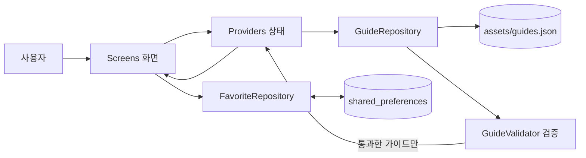
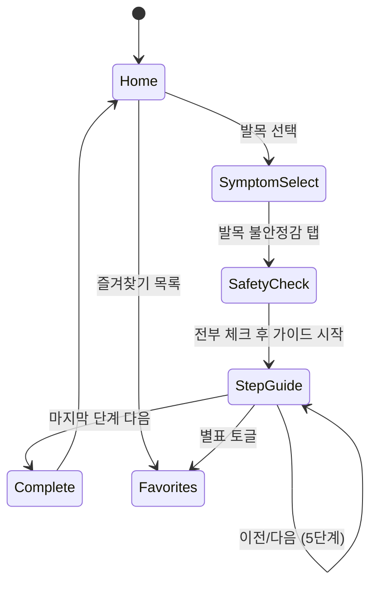
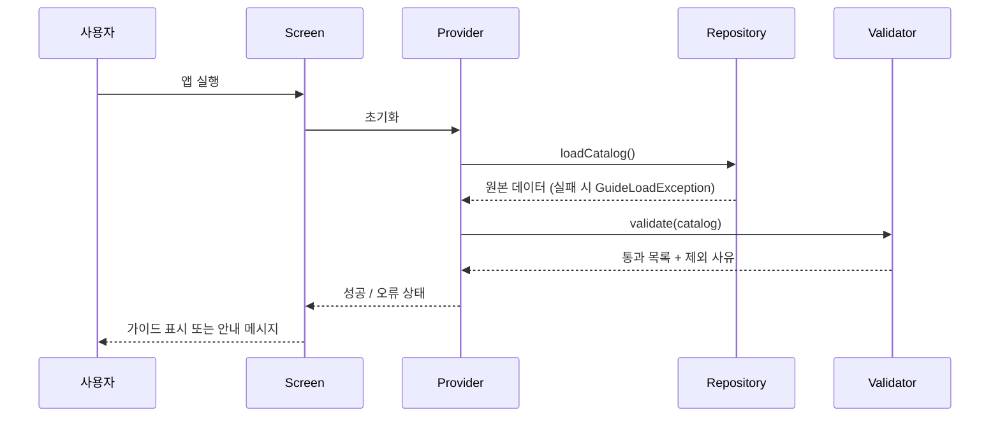

# TapeFit (테이프핏) — TRD (기술 요구사항 문서)

| 항목 | 내용 |
|---|---|
| 기준 문서 | `docs/PRD.md` (2026 마산대학교 해커톤, 팀 테이프핏) |
| 목적 | PRD의 MVP(발목 가이드)를 PRD가 확정한 기술(Flutter + 앱 내 번들 JSON)로 구현·검증하고, Firebase로 확장할 수 있는 구조를 정의한다 |
| 독자 | 심사위원(AI·사람), 개발팀(오준혁, 장아영, 송수민) |
| 상태 | 설계안. **구현·테스트 실행 결과는 8.1절에 날짜·환경과 함께 기록하며, 기록 전에는 "미실행"이다** |
| PRD와의 차이 | **없음.** MVP는 PRD 5장 "앱 내 로컬 JSON"을 그대로 따른다. Firebase는 PRD의 "추후 계획"에 해당하는 **Phase 2 확장 설계**(12장)로 분리했다 |

### 문서 지도

| 알고 싶은 것 | 위치 |
|---|---|
| 무엇을 만들고 무엇을 검증하나 (요구사항 ID) | 1장 |
| 기술 스택과 선택 이유 | 2장 |
| 구성요소와 각자의 책임, 화면 상태 | 3장 |
| 입력부터 결과까지의 흐름 | 4장 |
| 데이터 저장 구조 | 5장 |
| 화면·저장소가 주고받는 형식(API), 필드 규칙, 오류 코드 | 6장 |
| 문제 발생 시 동작과 안내 | 7장 |
| 요구사항 검증(테스트)과 실행 결과 | 8장 |
| 문제 → 요구사항 → 설계 → 구현 → 테스트 연결 | 9장 |
| 파일 구조 | 10장 |
| 구현 계획, 위험 | 11장 |
| Firebase 확장 설계 (Phase 2) | 12장 |

---

## 1. 요구사항과 범위

### 1.1 해결할 문제 (PRD 1장 인터뷰)

| 문제 | 근거 |
|---|---|
| 자료가 여러 가지라 어느 것이 맞는지 판단하기 어렵다 | 참가자 1·2 |
| 방법을 몰라 포기한다 | 참가자 2 |
| 붙인 뒤에도 제대로 붙였는지 불안하다 | 참가자 3 |

기술 목표: **출처와 검수 상태가 표시된 가이드 1가지를 단계별로 끝까지 따라 하게 하고, 근거가 확인되지 않은 내용은 화면에 내보내지 않는다.**

### 1.2 범위

| 구분 | 내용 | 우선순위 |
|---|---|---|
| 핵심 | 발목 1개 부위·증상 1개, 증상 선택 → 안전 체크 → 5단계 가이드 → 완료. 콘텐츠는 앱에 포함한 JSON에서 읽는다 | P0 |
| 즐겨찾기 | ☆ 저장, 앱 재실행 후에도 유지 (기기 로컬 저장) | P1 |
| 확장 (Phase 2) | Firestore 콘텐츠 배포, Remote Config 중단 스위치, 익명 로그인 기반 즐겨찾기 동기화, Analytics 완료율 측정 (12장) | P2 |
| 해커톤 이후 | 부위 선택 화면, 무릎·손목·어깨·허리, 3D, 음성, 근처 병원 안내 | P2 |
| 제외 | 이메일·소셜 로그인, 사용자 정보 수집, 자체 서버, 진단 기능 | — |

### 1.3 요구사항 ID

| ID | 요구사항 | PRD 근거 | 단계 |
|---|---|---|---|
| FR-01 | "발목 불안정감"을 누르면 안전 체크로 이동한다 | 5장 ① | MVP |
| FR-02 | 안전 체크 항목을 모두 체크해야 "가이드 시작"이 활성화된다 | 5장 ② | MVP |
| FR-03 | 5단계를 이전·다음으로 이동하며 단계마다 문구, 당김 강도, 출처, 테이프 그림을 표시한다 | 4-1, 5장 ③ | MVP |
| FR-04 | 마지막 단계 뒤 완료 화면에서 마무리 확인 사항을 안내하고 홈으로 돌아갈 수 있다 | 5장 ④ | MVP |
| FR-05 | ☆로 즐겨찾기를 저장하고, 앱을 다시 켜도 목록에서 다시 연다 | 5장 | MVP(P1) |
| FR-06 | 가이드마다 출처 목록과 검수 상태(검수 전 / 검수 완료 + 일자)를 표시한다 | 4장 차별점 | MVP |
| FR-07 | 면책 문구("진단·치료 대체 아님, 심하면 진료")를 가이드 화면에 항상 표시한다 | 6장 | MVP |
| FR-08 | 출처·검수 정보가 없거나, 단계가 6.2절 규칙(5단계, 1부터 연속·중복 없는 순서)에 맞지 않거나, 출처 참조가 끊어진 가이드는 화면에 노출하지 않는다 | 4장 콘텐츠 검수 기준 | MVP |
| FR-09 | 검수 전 항목은 보수적 문구와 "검수 전" 표시로 보여 준다 (호스슈 위치, "하루 이내 제거" 단정 금지) | 4-1 | MVP |
| FR-10 | 원격 스위치로 가이드 노출을 즉시 중단하고 점검 안내를 보여 준다 | 6장 안전 | **Phase 2** |
| FR-11 | 시작·안전 체크 통과·완료 이벤트를 기록해 완료율을 계산할 수 있다 | 5-1 성공 기준 | **Phase 2** |
| NFR-01 | 네트워크 없이 전체 흐름이 동작한다 (콘텐츠가 앱에 포함되므로 MVP에서 자동 충족) | 본 TRD | MVP |
| NFR-02 | 앱 실행 후 첫 화면이 2초 이내 표시된다 | 본 TRD | MVP |
| NFR-03 | 운영비 0원이다 (MVP는 서버가 없음. Phase 2는 Firebase 무료 플랜 범위) | 본 TRD | MVP / Phase 2 |
| NFR-04 | 이름·연락처·건강 상태 등 개인·건강정보를 수집·전송하지 않는다 (MVP는 외부 전송 자체가 없음) | 본 TRD | MVP |
| NFR-05 | 부위 추가가 앱 코드 변경 없이 콘텐츠(JSON) 추가만으로 가능하다 | 5장 중장기 | MVP |
| NFR-06 | 콘텐츠를 서버 쪽 쓰기 권한 통제 아래 갱신한다 | 본 TRD | **Phase 2** |

### 1.4 PRD와의 정합성 기록

| 항목 | PRD | 본 TRD | 조치 |
|---|---|---|---|
| 데이터 저장 | 5장 "앱 내 로컬 JSON, Firebase는 추후" | 번들 JSON (MVP), Firebase는 12장 | 일치 |
| 호스슈 문구 | 4-1 표: "스터럽 위에" (검수 전) | 5.2: "스터럽을 고정하는 용도" | PRD 4-1의 "검수 전에는 위치를 단정하지 않는다" 원칙에 따라 TRD의 보수적 문구가 우선. 송수민 검수 후 갱신 |
| 주의사항 개수 | 4-1 표 6건, 6-1 샘플 4건 | 6건 기준 (`content/guides.json`) | 6-1 샘플은 요약본(4건)임을 명시 |
| 데이터 형식 | 6-1: `source` 문자열, 주의사항 문자열 배열 | `sources[]`, `review`, `references`, 단계·주의사항별 출처 | **PRD 6-1 구조의 확장형.** 변경점은 5.1절 표 |
| 화면 흐름 | 흐름도에 "가이드 목록" 포함 | ①~④ 4개 화면 기준 (PRD 5장 표) | 가이드가 1개뿐이라 목록 화면은 생략. 부위·증상이 늘면 추가 |
| 즐겨찾기 | P1, 로컬 | 기기 로컬 저장 | 일치 |

---

## 2. 기술 스택

| 구분 | 결정 | 이유 |
|---|---|---|
| 클라이언트 | Flutter | PRD 확정. Android/iOS 단일 코드베이스 |
| 상태관리·라우팅 | Riverpod, go_router | 테스트가 쉽고 화면 ①~④ 흐름과 대응 |
| 콘텐츠 저장 | **앱에 포함한 JSON** (`assets/guides.json`) | PRD 확정. 서버·계정·설정이 없어 2일 안에 끝까지 구현해 검증할 수 있고, 오프라인·무료가 자동으로 충족된다 |
| 즐겨찾기 저장 | `shared_preferences` (증상 ID 목록) | 개인정보 없음, 서버 불필요 |
| 협업 | GitHub | PRD 확정 |

### 2.1 Firebase를 MVP에서 쓰지 않는 이유

| 비교 | 번들 JSON (채택) | Firebase |
|---|---|---|
| 해커톤 2일 일정 | 설정할 것이 없음 | 프로젝트·규칙·시드 설정에서 시간을 잃기 쉬움 |
| 시연 장소 네트워크 | 영향 없음 | 첫 실행 폴백이 필요 |
| 콘텐츠 갱신 | 앱 재배포 필요 | 재배포 없이 가능 (큰 장점) |
| 개인정보·보안 | 외부 전송 없음 | 규칙 설계·검증 필요 |

콘텐츠를 앱 재배포 없이 바꾸는 이점은 해커톤 이후에 의미가 크므로 **Phase 2(12장)로 설계만 유지**한다. 전환 비용을 낮추기 위해 앱은 처음부터 `GuideRepository` 인터페이스 뒤에서 데이터를 읽는다 (6.1절). Phase 2에서는 구현체 하나만 추가·교체한다.

---

## 3. 시스템 구조

### 3.1 구성요소와 책임



| 구성요소 | 책임 | 하지 않는 일 |
|---|---|---|
| Screens | 탭 입력 수신, 상태 렌더링, 화면 이동 | 데이터 로딩, 검증 |
| Providers | 증상·단계·안전 체크 상태 관리, 로딩/성공/오류 상태 결정 | 파일·저장소 세부 호출 |
| GuideRepository | JSON 로드·파싱, `GuideCatalog` 반환 | UI 로직 |
| GuideValidator | 필수 필드·출처 참조·단계 규칙 검증, 부적합 가이드 제거 | 콘텐츠 수정 |
| FavoriteRepository | 즐겨찾기 증상 ID 읽기·쓰기, 없는 ID 정리 | 가이드 조회 |
| TapeDiagram | `tape` 좌표를 `CustomPainter`로 그림 | 문구 표시 |
| 콘텐츠 검증 도구 (`tool/validate_content.mjs`) | 콘텐츠 JSON 변경 시 같은 규칙을 CI 없이 로컬에서 실행 | 앱 실행 중 동작 |

### 3.2 화면 상태 전이



---

## 4. 데이터 흐름

입력 → 로드 → 검증 → 상태 반영 → 안전 체크 → 표시 → 보관 순서로 이동한다.

| 순서 | 단계 | 내용 | 담당 |
|---|---|---|---|
| 1 | 입력 | 앱 실행 | Screens |
| 2 | 로드 | `assets/guides.json`을 읽어 파싱 | GuideRepository |
| 3 | 검증 | 증상마다 `sources`, `review`, `steps`, `cautions` 확인. 부적합 증상은 제외하고 사유를 기록 | GuideValidator |
| 4 | 상태 반영 | 통과 데이터를 로딩/성공/오류 상태로 노출 | Providers |
| 5 | 안전 체크 | `cautions`를 전부 체크해야 "가이드 시작" 활성화 | Providers, Screens |
| 6 | 표시 | 단계 문구, 당김 강도, 출처, 검수 상태, 면책 문구, 테이프 그림 | Screens |
| 7 | 보관 | 별표 토글 시 증상 ID를 로컬에 저장 | FavoriteRepository |



---

## 5. 데이터 저장 구조

### 5.1 파일 구조와 PRD 6-1 대비 변경점

```
assets/guides.json  (= content/guides.json 의 복사본)
  meta        { contentVersion, schemaVersion, disclaimer }
  bodyParts[] { id, name, available, order }
  guides[]    { id, bodyPartId, name, tape, tapeNeeded, sources[], published,
                review{status, reviewer, reviewedAt},
                steps[{order,title,body,tension,sources[],tape[][][]}],
                cautions[{text,sources[]}] }
  references[] { id, type, title, url? }        // S1 ~ S6
즐겨찾기(로컬): shared_preferences 키 `favorites` = 증상 ID 문자열 목록
```

| 결정 | 이유 |
|---|---|
| 가이드 1건 = 객체 1개, 단계·주의사항 내장 | 부위 추가 = `guides[]`·`bodyParts[]` 항목 추가 (NFR-05) |
| `references`를 별도 목록 | 출처 상세를 한 곳에서 관리하고 단계·주의사항에서 ID로 참조 |
| `published` 필드 | 검수 중 콘텐츠를 앱에 노출하지 않고 준비 (false이면 Validator가 제외) |
| `tape` 좌표 | PRD 6-1과 같은 형식을 유지해 그림을 앱에서 그림 |

PRD 6-1 샘플 대비 변경점: `source` 문자열 → `sources` ID 배열과 `references` 목록, `review` 객체, 단계·주의사항별 출처, `published`, 버전 필드. 이는 FR-06·FR-08(출처·검수 표시와 차단)을 구현하기 위한 확장이다.

### 5.2 문서 예시 (`ankle_instability`, 5단계 전체)

```jsonc
{
  "id": "ankle_instability",
  "bodyPartId": "ankle",
  "name": "발목 불안정감 (가벼운 염좌 후)",
  "tape": "리지드 테이프 + 언더랩",
  "tapeNeeded": "리지드 테이프, 언더랩, 가위",
  "sources": ["S3", "S5", "S6"],
  "published": true,
  "review": { "status": "pending", "reviewer": "송수민", "reviewedAt": null },
  "steps": [
    { "order": 1, "title": "피부 준비",
      "body": "땀과 오염을 씻고 말리세요. 체모는 제거하고, 상처는 거즈로 덮으세요. 붙이는 동안 움직이지 마세요.",
      "tension": "없음", "sources": ["S3"], "tape": [] },
    { "order": 2, "title": "앵커",
      "body": "종아리 근육 바로 아래쪽에 테이프를 2~3줄 둘러 시작점을 고정하세요.",
      "tension": "당기지 않음", "sources": ["S3", "S5"],
      "tape": [[[80, 96], [130, 96]]] },
    { "order": 3, "title": "스터럽",
      "body": "발 안쪽에서 발뒤꿈치 아래를 지나 바깥쪽으로 U자로 붙여 인대를 지지하세요. 총 3줄을 붙입니다.",
      "tension": "약하게", "sources": ["S3", "S5"],
      "tape": [[[82, 96], [82, 150], [86, 190], [105, 206], [124, 190], [128, 150], [128, 96]]] },
    { "order": 4, "title": "호스슈",
      "body": "스터럽을 고정하는 용도로 말발굽 모양으로 붙여 발목이 좌우로 흔들리지 않게 하세요. (붙이는 위치는 송수민 검수 예정)",
      "tension": "약하게", "sources": ["S3"],
      "tape": [[[128, 150], [112, 178], [96, 186], [82, 160]]] },
    { "order": 5, "title": "마무리 확인",
      "body": "앤드로 끝맺고, 조이거나 아프면 떼고 다시 붙이세요. 피부가 창백하거나 테이프가 파고들면 너무 강한 것입니다.",
      "tension": "당기지 않음", "sources": ["S3"],
      "tape": [[[80, 90], [130, 90]], [[80, 102], [130, 102]]] }
  ],
  "cautions": [
    { "text": "조이거나 아프면 다시 붙이고, 붙인 테이프 위에 덧붙이지 말고, 구김 없이 붙이세요.", "sources": ["S3"] },
    { "text": "골절·탈구가 의심되면 테이핑만 믿고 움직이지 마세요.", "sources": ["S3"] },
    { "text": "붓기·멍이 심하거나 체중을 실을 수 없으면 테이핑 전에 전문의 진료를 받으세요.", "sources": ["S6"] }
  ]
}
```

단계 5개는 전체를 실었고 주의사항은 지면상 3건만 싣는다 (전체 6건은 `content/guides.json`). 이 예시가 6.2절 규칙을 모두 통과하는지는 T-01이, 규칙을 어긴 사례가 거부되는지는 T-25가 검증한다.

### 5.3 도메인 모델 (Dart)

| 모델 | 필드 |
|---|---|
| `GuideCatalog` | `contentVersion`, `disclaimer`, `bodyParts`, `references`, `excluded`(제외된 증상과 사유) |
| `BodyPart` | `id`, `name`, `available`, `symptoms` |
| `Symptom` | `id`, `name`, `tape`, `tapeNeeded`, `sources`, `review`, `steps`, `cautions` |
| `TapeStep` | `order`, `title`, `body`, `tension`, `sources`, `tape` |
| `Caution` | `text`, `sources` |
| `Review` | `status`(pending / verified), `reviewer`, `reviewedAt` |
| `Reference` | `id`, `type`, `title`, `url` |

---

## 6. 인터페이스(API) 계약

서버가 없으므로 **화면 ↔ Repository 계약**과 **JSON 필드 규칙**을 약속으로 고정한다.

### 6.1 Repository 계약 (Dart)

| 메서드 | 입력 | 응답 | 실패 시 |
|---|---|---|---|
| `Future<GuideCatalog> loadCatalog()` | 없음 | 검증 통과분과 제외 사유를 담은 `GuideCatalog` | `GuideLoadException(code, message)` |
| `Future<Symptom> getSymptom(String id)` | 증상 ID | `Symptom` | `GuideNotFoundException` |
| `Stream<Set<String>> watchFavorites()` | 없음 | 즐겨찾기 증상 ID 집합 | 빈 집합 |
| `Future<void> toggleFavorite(String id)` | 증상 ID | 없음 | `StorageException` |

Phase 2에서 `getConfig()`, `logEvent()`가 추가되지만 위 메서드는 바뀌지 않는다 (12.5절).

### 6.2 문서 필드 규칙 (검증 기준)

#### 필드 타입·길이·허용값

| 객체.필드 | 타입 | 필수 | 길이·허용값 |
|---|---|---|---|
| `meta.contentVersion` | string | ✔ | `^\d+\.\d+\.\d+$` (연.월.일련번호) |
| `meta.schemaVersion` | int | ✔ | 1 |
| `meta.disclaimer` | string | ✔ | 1~200자 |
| `bodyParts[].id` | string | ✔ | `^[a-z0-9_]{1,64}$`, 목록 내 유일 |
| `bodyParts[].name` | string | ✔ | 1~20자 |
| `bodyParts[].available` / `order` | bool / int | ✔ | `order`는 1 이상 |
| `guides[].id` | string | ✔ | `^[a-z0-9_]{1,64}$`, 목록 내 유일 |
| `guides[].bodyPartId` | string | ✔ | `bodyParts[].id`에 존재 |
| `guides[].name`, `tape`, `tapeNeeded` | string | ✔ | 1~80자 |
| `guides[].sources` | string[] | ✔ | 1개 이상, 중복 없음, 모두 `references[].id`에 존재 |
| `guides[].published` | bool | ✔ | false이면 노출하지 않음 |
| `guides[].review.status` | string | ✔ | `pending` 또는 `verified` |
| `guides[].review.reviewer` | string | ✔ | 1~20자 |
| `guides[].review.reviewedAt` | string/null | 조건부 | `verified`이면 필수, `YYYY-MM-DD` |
| `steps[].order` | int | ✔ | 아래 "단계 규칙" |
| `steps[].title` | string | ✔ | 1~20자 |
| `steps[].body` | string | ✔ | 1~300자 |
| `steps[].tension` | string | ✔ | `없음` / `당기지 않음` / `약하게` / `보통` 중 하나 |
| `steps[].sources` | string[] | ✔ | 1개 이상, 중복 없음, 모두 존재하는 출처 ID |
| `steps[].tape` | number[][][] | 선택 | 아래 "그림 좌표 규칙" |
| `cautions[]` | 객체 | ✔ | 1개 이상. `text` 1~200자, `sources`는 존재하는 출처 ID (빈 배열 허용 안 함) |
| `references[].id` | string | ✔ | `^S\d+$`, 유일 |
| `references[].type` / `title` | string | ✔ | `type`은 `학술` / `의료기관` / `교육 자료` / `콘텐츠 검수` 중 하나, `title` 1~200자 |
| `references[].url` | string | 선택 | 있으면 `https://`로 시작 |

#### 단계 규칙

- 발목 MVP는 **정확히 5개** (피부 준비 → 앵커 → 스터럽 → 호스슈 → 마무리 확인). 필요한 단계 수는 증상별 `expectedSteps`(검증 도구·앱 공통 설정)로 고정한다.
- `order`는 1부터 N까지 **연속·중복 없음**. 배열 순서가 달라도 앱은 `order`로 정렬해 표시한다.
- 누락·중복·0 이하의 `order`가 있거나 단계 수가 맞지 않으면 **증상 전체를 제외**한다.

#### 그림 좌표 규칙

각 줄은 점 2개 이상이고, 점은 `[x, y]` 숫자 쌍이며 **x는 0~210, y는 0~230 범위**다. 위반하면 그림만 생략하고 문구는 표시한다.

#### 버전 규칙

`contentVersion`은 점으로 나눈 세 정수를 앞 칸부터 숫자로 비교한다 (`2026.11.10 > 2026.11.2`). 형식이 틀리면 콘텐츠를 거부한다. (MVP는 앱에 포함된 단일 콘텐츠라 비교 대상이 하나뿐이고, 후보가 여러 개가 되는 Phase 2에서 선택 규칙을 쓴다. 12.3절)

#### 오류 코드 매핑

| 위반 | 코드 | 처리 | 사용자 안내 (7장) |
|---|---|---|---|
| JSON을 읽을 수 없거나 구문 오류 | `LOAD_FAILED` | 오류 화면 + 재시도 | "가이드를 불러오지 못했어요." |
| 필수 필드 누락·타입 오류 (가이드 단위) | `SCHEMA_INVALID` | 해당 증상 제외 | 없음 |
| `sources`/`review` 누락, 출처 ID 끊어짐·중복 | `SOURCE_INVALID` | 해당 증상 제외 | 없음 |
| `verified`인데 `reviewedAt` 없음 | `REVIEW_INVALID` | 해당 증상 제외 | 없음 |
| 단계 수·순서 위반 | `STEPS_INVALID` | 해당 증상 제외 | 없음 |
| `bodyPartId` 없음 | `REF_INVALID` | 해당 증상 제외 | 없음 |
| 좌표 범위 위반 | `TAPE_INVALID` | 그림만 생략 | "그림을 표시할 수 없어요." |
| `contentVersion` 형식 오류 | `VERSION_INVALID` | 전체 로드 실패로 처리 | "가이드를 불러오지 못했어요." |
| 제외 후 남은 증상 없음 | `EMPTY_CATALOG` | 안내 화면 | "현재 제공 가능한 가이드가 없습니다." |

#### 규칙의 이중 검증과 동등성

같은 규칙을 **두 곳**에서 확인한다: 콘텐츠 JSON 변경 시 실행하는 검증 도구(`tool/validate_content.mjs`)와 앱의 `GuideValidator`. 두 구현이 규칙을 다르게 해석하지 않도록, 잘못된 데이터 사례(`test/fixtures/invalid_cases.json`: 출처 누락, 끊어진 참조, 단계 중복·누락, 좌표 범위 밖, 잘못된 버전 형식, 없는 `bodyPartId`)를 **같은 파일로 두 구현이 모두 거부**하는지 테스트한다 (T-25).

---

## 7. 오류 처리

원칙: 오류가 나도 **잘못된 의료 안내가 노출되지 않는 방향(차단·제외)** 으로 실패하고, 앱은 종료되지 않는다.

| 상황 | 동작 | 사용자 안내 |
|---|---|---|
| 번들 JSON 로드·파싱 실패 | 로딩 중단, 재시도 버튼 | "가이드를 불러오지 못했어요. 다시 시도해 주세요." |
| 출처·검수 필드 누락 증상 | 해당 증상만 제외, 사유 기록 | (표시 없음) |
| 단계 수·순서 위반(누락·중복·역순) | 해당 증상 전체 제외 | (표시 없음) |
| 제외 후 남은 증상 없음 | 빈 화면 대신 안내 | "현재 제공 가능한 가이드가 없습니다." |
| 안전 체크 미완료 | 시작 버튼 비활성, 미체크 항목 강조 | "모든 주의사항을 확인해 주세요." |
| 없는 증상 ID / 잘못된 경로 | 홈으로 이동 | "찾을 수 없는 가이드입니다." |
| 즐겨찾기 저장 실패 | 화면 상태를 되돌림 | "즐겨찾기를 저장하지 못했어요." |
| `tape` 좌표 오류 | 그림만 생략, 문구는 표시 | "그림을 표시할 수 없어요." |
| 예상치 못한 예외 | 전역 핸들러가 안내 화면 표시 | "문제가 발생했어요. 홈으로 돌아가 주세요." |

Phase 2의 오류(서버 실패, 원격 스위치 등)는 12.4절에 둔다.

---

## 8. 테스트 계획 (요구사항이 실제로 지켜지는지 확인)

| ID | 검증 내용 | 요구사항 | 유형 | 합격 기준 |
|---|---|---|---|---|
| T-01 | 5.2절 예시 문서가 스키마대로 파싱되고 6.2절 규칙을 모두 통과한다 (5단계 전체) | FR-03, FR-08 | 단위 | 필수 필드 로드, 검증 오류 0건 |
| T-02 | 출처가 없는 증상이 제거된다 | FR-08 | 단위 | 목록에 없고 `excluded`에 사유가 남음 |
| T-03 | `verified`인데 `reviewedAt`이 없으면 제거된다 | FR-06, FR-08 | 단위 | 제외됨 |
| T-04 | `references`에 없는 출처 ID를 가진 증상이 제거된다 | FR-08 | 단위 | 제외됨 |
| T-05 | 증상을 누르면 안전 체크로 이동한다 | FR-01 | 위젯 | 안전 체크 화면 |
| T-06 | 전부 체크 전에는 시작 버튼이 비활성, 전부 체크하면 활성화된다 | FR-02 | 위젯 | 상태가 일치 |
| T-07 | 5단계를 이동하며 문구·당김 강도·출처가 모두 표시된다 | FR-03 | 위젯 | 5개 단계 모두 확인 |
| T-08 | 마지막 단계 뒤 완료 화면이 나오고 홈으로 돌아간다 | FR-04 | 위젯 | 흐름 ①~④ 통과 |
| T-09 | 가이드 화면에 검수 상태와 면책 문구가 항상 보인다 | FR-06, FR-07 | 위젯 | 텍스트 존재 |
| T-10 | 즐겨찾기 저장 후 앱을 다시 만들어도 목록에 남는다 | FR-05 | 위젯+저장소 | 저장·복원 일치 |
| T-11 | 번들 JSON 로드 실패 시 오류 안내와 재시도가 나온다 | 7장 | 단위+위젯 | 크래시 없음 |
| T-12 | 검수 전 항목에 "검수 전" 표시가 붙고 호스슈 위치·하루 이내 제거를 단정하지 않는다 | FR-09 | 단위(데이터 점검) | `pending` 표시, 단정 문구 없음 |
| T-13 | `guides.json`에 부위·증상 항목만 추가해도 코드 수정 없이 표시된다 | NFR-05 | 단위 | 새 부위가 목록에 노출 |
| T-19 | 콘텐츠 원본 JSON이 검증 도구를 통과한다. 위반 시 종료 코드가 0이 아니다 | FR-08 | 스크립트 | 위반 시 실패 |
| T-20 | 비행기 모드에서 전체 흐름이 동작한다 | NFR-01 | 수동 | 정상 완료 |
| T-21 | 콜드 스타트 후 첫 화면 표시 시간 | NFR-02 | 수동 | 2초 이내 |
| T-23 | PRD 5장 "화면별 완료 조건" 점검 | FR-01~05 | 수동 | 각 시점 통과 |
| T-24 | `flutter analyze`, `flutter test`가 통과한다 | 전체 | 로컬 실행 | 제출·시연 전 성공 |
| T-25 | 잘못된 데이터 사례(`invalid_cases.json`)를 검증 도구와 앱 Validator가 **모두** 거부한다. 각 사례가 6.2절 오류 코드와 대응한다 | FR-08 | 단위+스크립트 | 같은 파일에 두 구현이 모두 거부 |
| T-26 | 버전 비교: `2026.11.10 > 2026.11.2`, 형식 오류는 거부 | 6.2 버전 규칙 | 단위 | 숫자 비교가 맞음 |
| T-31 | 단계 `order` 중복·누락·역순 배열·단계 수 부족을 증상 단위로 제외하고, 역순 배열은 `order` 순서로 표시한다 | FR-08 | 단위 | 규칙대로 제외/정렬 |
| T-32 | 즐겨찾기에 존재하지 않는 증상 ID가 저장돼 있으면 목록에서 정리된다 | FR-05 | 단위 | 존재하는 ID만 남음 |

Phase 2 테스트(T-14~T-18, T-22, T-27~T-30, T-10b)는 12.6절에 둔다.

### 8.1 실행 결과 기록

위 계획은 **설계이며, 아래 표가 채워지기 전까지 통과로 간주하지 않는다.** 실행할 때마다 날짜·환경·결과를 기록한다. 실행하지 않은 항목은 "미실행"으로 남긴다.

| 범위 | 대상 테스트 | 실행일 | 환경 | 결과 |
|---|---|---|---|---|
| 단위·위젯 | T-01~T-13, T-25, T-26, T-31, T-32 | (미실행) | `flutter test` | — |
| 정적 분석 | T-24 (`flutter analyze`) | (미실행) | 로컬 | — |
| 콘텐츠 검증 | T-19 | (미실행) | `node tool/validate_content.mjs` | — |
| 수동 | T-20, T-21, T-23 | (미실행) | 실기기 | — |
| 사용자 테스트 | PRD 5-1 | (미실행) | 초보자 관찰 | — |
| 콘텐츠 검수 | 송수민 검수 (`review.status`) | (미실행) | — | `pending` |

사용자 테스트(완료율 80%, 이해도 4점, 안전 3문항 전원 정답 등)는 제품 검증으로, PRD 5-1에 따라 별도 진행한다. 제출 시 이 표를 실제 결과로 갱신하고 코드 저장소 링크와 실행 화면을 함께 첨부한다.

---

## 9. 추적성 (문제 → 요구사항 → 설계 → 구현 → 테스트)

| PRD 문제 | 요구사항 | 설계 | 구현 | 테스트 |
|---|---|---|---|---|
| 어떤 자료가 맞는지 판단하기 어렵다 | FR-06 출처·검수 표시 | 5.1, 6.2 | `guide/widgets/source_badge.dart` | T-07, T-09 |
| 〃 | FR-08 근거 없는 가이드 차단 | 4장 3단계, 6.2 | `core/validation.dart`, `tool/validate_content.mjs` | T-02, T-03, T-04, T-19, T-25, T-31 |
| 〃 | FR-09 검수 전 보수적 문구 | 5.1 `review` | `content/guides.json`, `source_badge.dart` | T-12 |
| 방법을 몰라 포기한다 | FR-01, FR-03 | 3.2 | `symptom_select_screen.dart`, `step_guide_screen.dart`, `tape_diagram.dart` | T-01, T-05, T-07, T-23 |
| 제대로 붙였는지 불안하다 | FR-04 마무리 확인 | 3.2 | `complete_screen.dart` | T-08 |
| 잘못 붙이면 피부·혈액순환 문제 | FR-02 안전 체크 게이트 | 4장 5단계 | `safety_check_screen.dart`, `guide_session_provider.dart` | T-06 |
| 의학 치료로 오해할 수 있다 | FR-07 면책 문구 | 5.1 `meta` | 공통 위젯 | T-09 |
| 다시 찾기 번거롭다 | FR-05 즐겨찾기 | 5.1, 6.1 | `favorite_repository.dart`, `favorites_screen.dart` | T-10, T-32 |
| 운동·부상 현장에서 쓴다 | NFR-01, NFR-02 | 2장 번들 JSON | `guide_repository.dart`, `assets/guides.json` | T-11, T-20, T-21 |
| 개인정보 | NFR-04 | 1.2 제외 항목 | 외부 전송 코드 없음 | T-23 (수동 점검) |
| 콘텐츠 확장·검수 반영 | NFR-05 | 5.1 | `content/guides.json` | T-13 |
| 오류 시 안전하게 실패 | 7장 전체 | 6.2 오류 코드 | `core/validation.dart`, 전역 핸들러 | T-11, T-31 |
| 원격 중단·완료율 측정·서버 갱신 | FR-10, FR-11, NFR-06 | 12장 (Phase 2) | — | 12.6절 |

유지 규칙: 요구사항 ID가 바뀌면 이 표와 테스트 이름(`test('FR-02: ...')`)을 함께 고치고, PR 설명에 영향받는 ID를 적는다.

---

## 10. 파일 구조

```
TapeFit/
├─ docs/
│  ├─ PRD.md
│  └─ TRD.md
├─ content/
│  └─ guides.json                        # 콘텐츠 원본 (Git 이력 관리)
├─ assets/
│  └─ guides.json                        # 앱에 포함되는 복사본 (현재 저장소는 assets/fallback/guides.json 경로를 사용)
├─ lib/
│  ├─ main.dart                          # ProviderScope, 전역 오류 핸들러
│  ├─ app/
│  │  ├─ router.dart                     # /, /symptoms, /safety, /guide, /complete, /favorites
│  │  └─ theme.dart
│  ├─ domain/
│  │  ├─ guide_models.dart               # 5.3절 모델
│  │  └─ guide_repository.dart           # abstract GuideRepository (6.1절) — Phase 2에서도 유지
│  ├─ data/
│  │  ├─ fallback_guide_source.dart      # 번들 JSON 로더 (MVP의 콘텐츠 원천)
│  │  ├─ favorite_repository.dart        # 로컬 저장 즐겨찾기
│  │  ├─ firestore_guide_repository.dart # [Phase 2] Firestore + 번들 폴백
│  │  └─ (config_service / auth_service / analytics_service)  # [Phase 2] 미구현
│  ├─ application/
│  │  ├─ guide_providers.dart
│  │  └─ guide_session_provider.dart     # 안전 체크 상태, 현재 단계
│  ├─ core/
│  │  └─ validation.dart                 # GuideValidator (6.2절 규칙)
│  ├─ firebase_options.dart              # [Phase 2] flutterfire configure 결과
│  └─ presentation/
│     ├─ home/home_screen.dart
│     ├─ symptom/symptom_select_screen.dart   # ①
│     ├─ safety/safety_check_screen.dart      # ②
│     ├─ guide/step_guide_screen.dart         # ③
│     ├─ guide/widgets/tape_diagram.dart      # CustomPainter
│     ├─ guide/widgets/source_badge.dart      # 출처·검수 상태
│     ├─ complete/complete_screen.dart        # ④
│     └─ favorites/favorites_screen.dart
├─ tool/
│  ├─ validate_content.mjs               # 콘텐츠 검증 (6.2절 규칙)
│  └─ seed/seed.mjs                      # [Phase 2] Admin SDK 업로드 (서비스 계정 키는 저장소에 올리지 않음)
├─ test/
│  ├─ validation_test.dart               # T-01~T-04, T-12, T-25(Dart), T-26, T-31
│  ├─ fixtures/invalid_cases.json        # 잘못된 데이터 사례 (검증 도구와 앱이 같은 파일로 테스트)
│  ├─ safety_check_test.dart             # T-06
│  ├─ flow_test.dart                     # T-05, T-07~T-09
│  └─ favorites_test.dart                # T-10, T-32
├─ firestore.rules, firestore.indexes.json, firebase.json   # [Phase 2] 지금은 사용하지 않음
└─ pubspec.yaml
```

표시한 **[Phase 2]** 파일은 현재 저장소에 초안이 있으나 MVP의 동작·테스트·합격 기준에 포함하지 않는다. `firebase_options.dart`는 실제 연동 전까지 초기화 실패 → 번들 폴백으로 동작하는 자리표시자다.

핵심 의존성(MVP): `flutter_riverpod`, `go_router`, `shared_preferences`. Firebase 패키지(`firebase_core`, `cloud_firestore` 등)는 Phase 2에서 활성화한다.

### 10.1 구현 상태 (정직한 기록)

| 항목 | 상태 |
|---|---|
| 화면 ①~④, 안전 체크, 테이프 그림, 검증기(Dart·Node), 번들 콘텐츠 | 코드 작성됨 (빌드·테스트 **미실행**) |
| 즐겨찾기 영구 저장 | 현재는 메모리 저장. `shared_preferences` 전환은 **미구현** |
| `guides.json` 번들 경로 | 현재 `assets/fallback/guides.json`. 위 구조의 `assets/guides.json`으로 정리는 **미구현** |
| T-25 Dart↔Node 동등성 테스트 코드, T-31, T-32 | **미구현** |
| Phase 2 (Firebase 연동 전체) | 설계만 있음 (12장) |

---

## 11. 구현 계획과 위험

### 11.1 일정 (PRD 5장 2일 계획과 정렬)

| 시점 | 작업 | 담당(안) | 완료 조건 |
|---|---|---|---|
| 1일차 오전 | Flutter 프로젝트, 모델·번들 JSON 로드·검증 | 송수민, 장아영 | T-01~T-04, T-11 통과 |
| 1일차 오후 | ① 증상 선택, ② 안전 체크, ③ 단계별 가이드(출처·당김 강도·그림) | 오준혁, 송수민 | PRD 완료 조건 ①~③ (T-05~T-07) |
| 2일차 오전 | ④ 완료 화면, 전체 흐름 점검 → 통과 후 디자인, P1 즐겨찾기 | 장아영, 오준혁 | T-08~T-10 |
| 2일차 오후 | 사용자 테스트, 수정, APK 빌드, 발표 준비, **8.1절 결과 기록** | 전원 | 최소 시연 기준 충족, T-20~T-24 |

서버·계정 설정이 없어 사전 준비가 필요 없다. 일정이 밀리면 **즐겨찾기 → 디자인 개선** 순으로 제외하고, P0(①~④ 흐름)만 유지한다.

### 11.2 이후 로드맵

| 단계 | 기술 작업 |
|---|---|
| Phase 2 | Firebase 연동 (12장), 무릎·손목 등 콘텐츠 추가, 부위 선택 화면 |
| Phase 3 | 3D·음성 가이드, 근처 병원 안내(지도 API 검토) |

### 11.3 위험과 대응

| 위험 | 대응 |
|---|---|
| 검수 전 부정확한 의료 문구 | FR-08, FR-09, 면책 문구, `published` 플래그, 보수적 문구 원칙 |
| 구현 일정 지연 | P1(즐겨찾기)부터 제외, P0 흐름 유지 |
| 콘텐츠 갱신에 앱 재배포 필요 | 해커톤 범위에서는 수용. Phase 2에서 해소 |
| 검증 도구와 앱 Validator의 규칙 불일치 | 같은 사례 파일로 두 구현을 테스트 (T-25) |
| 설계만 있고 실행 증거가 없음 | 8.1절에 날짜·환경·결과를 기록하고, 미실행은 미실행으로 표기 |

---

## 12. Phase 2 확장 설계: Firebase

> 이 장은 **해커톤 이후 확장 설계**다. MVP의 합격 기준에 포함하지 않으며, 코드·규칙 초안은 저장소에 있으나 실행·검증되지 않았다. 아래 무료 플랜 한도 수치는 **확인 필요**이며, 도입 시점에 Firebase 공식 문서(가격 페이지)로 확인한 날짜와 출처를 이 장에 기록한다.

### 12.1 서비스와 선택 이유

| 서비스 | 용도 | 대응 요구사항 |
|---|---|---|
| Cloud Firestore | 가이드·출처·공통 문구 읽기, 즐겨찾기 동기화 | NFR-05, NFR-06 |
| Remote Config | `guidesEnabled`, `minContentVersion` | FR-10 |
| Authentication (익명) | 즐겨찾기를 기기별로 분리·복원하는 익명 UID | FR-05 |
| Analytics | 완료율 이벤트 | FR-11 |

후보 비교: Firebase Spark(Flutter 1급 지원, 모바일 오프라인 캐시, 규칙으로 보안 선언 — 채택 후보), Supabase(SQL이지만 무료 프로젝트 일시중지로 시연 위험), Cloudflare Pages+D1(모바일 SDK 없음). 벤더 종속은 `GuideRepository` 인터페이스와 Git의 JSON 원본으로 완화한다. 무료 플랜 유지를 위해 결제 수단을 등록하지 않고 사용량 알림을 켠다.

### 12.2 데이터 구조와 보안 규칙

콘텐츠 원본은 Git의 JSON이고 Firestore는 배포 대상이다. 컬렉션: `meta/app`, `bodyParts/{id}`, `guides/{symptomId}`(steps·cautions 내장), `references/{sourceId}`, `users/{uid}/favorites/{symptomId}`. 필드 규칙은 6.2절을 그대로 쓴다.

```
rules_version = '2';
service cloud.firestore {
  match /databases/{db}/documents {
    match /meta/{id}       { allow read: if true; allow write: if false; }
    match /bodyParts/{id}  { allow read: if true; allow write: if false; }
    match /references/{id} { allow read: if true; allow write: if false; }
    match /guides/{id} {
      allow read: if resource.data.published == true;
      allow write: if false;
    }
    match /users/{uid}/favorites/{symptomId} {
      allow read, delete: if request.auth != null && request.auth.uid == uid;
      allow create, update: if request.auth != null && request.auth.uid == uid
        && symptomId.matches('^[a-z0-9_]{1,64}$')
        && request.resource.data.keys().hasOnly(['createdAt'])
        && request.resource.data.createdAt == request.time;
    }
  }
}
```

가이드 목록 조회는 규칙과 호환되도록 **`collection('guides').where('published', isEqualTo: true)`로만** 한다 (조건 없는 조회는 거부됨). 쓰기는 Admin SDK(`tool/seed`, 규칙 우회)만 하며, 서비스 계정 키는 저장소에 올리지 않는다.

### 12.3 콘텐츠 버전과 설정 실패 정책 (안전하게 실패)

**사용할 콘텐츠 선택**: 원격·캐시·번들 후보 중 (1) 6.2절 검증을 통과하고 (2) `minContentVersion` 이상인 것만 후보로 두고, 그중 `contentVersion`이 가장 높은 것을 쓴다. 후보가 없으면 점검 화면. 비교 대상은 앱 빌드가 아니라 **콘텐츠 본체**의 `contentVersion`이다.

| 상황 | 동작 |
|---|---|
| `guidesEnabled` 조회 성공 | 그 값을 저장하고 사용 |
| 조회 실패, 마지막 성공 값이 24시간 이내 | 마지막 성공 값 사용 |
| 조회 실패, 마지막 성공 값이 `false` | 만료와 무관하게 `false` 유지 (`true`를 받을 때까지 차단) |
| 조회 실패, 값이 없거나 24시간 초과 | "상태 미확인": **번들 콘텐츠만** 허용, 안내 배너 표시 (기본값 `true`로 열지 않음) |
| 캐시 콘텐츠가 `minContentVersion` 미만 | 캐시 폐기 후 서버 재조회, 오프라인이면 번들이 기준을 충족할 때만 번들, 아니면 점검 화면 |
| 캐시 콘텐츠의 나이 | 만료로 막지 않음. 마지막 서버 확인이 7일을 넘으면 "마지막 확인: N일 전" 표시 |

### 12.4 Phase 2 오류 처리

| 상황 | 동작 | 사용자 안내 |
|---|---|---|
| 서버 읽기 실패 | 캐시 → 번들 순 폴백 | "오프라인 데이터로 표시 중입니다." |
| `guidesEnabled=false` 또는 콘텐츠 버전 < `minContentVersion` | 가이드 진입 차단 | "현재 가이드를 점검 중입니다." |
| Remote Config 조회 실패 | 12.3절 정책 | 상태 미확인일 때만 "최신 상태를 확인하지 못했어요." |
| 익명 로그인 실패 | 즐겨찾기 동기화만 비활성 (로컬 저장은 유지) | "즐겨찾기를 지금은 사용할 수 없어요." |
| 무료 한도 초과로 읽기 거부 | 캐시·번들 폴백 | "오프라인 데이터로 표시 중입니다." |
| Analytics 실패 | 무시 | 없음 |

### 12.5 추가 인터페이스

| 메서드 | 응답 | 실패 시 |
|---|---|---|
| `Future<AppConfig> getConfig()` | `AppConfig{guidesEnabled, minContentVersion, fetchedAt, isStale}` | 12.3절 정책 |
| `void logEvent(AppEvent e)` | 없음 | 무시 |

Analytics 이벤트(파라미터에 개인정보 없음): `guide_start`, `safety_pass`, `step_view`, `guide_complete`(`symptom_id`, `step_order`), `favorite_toggle`(`symptom_id`, `on`). `guide_start`·`safety_pass`·`guide_complete`는 가이드 진행 1회에 **최대 1번**만 보내며, 앱 메모리의 진행 플래그로 판단해 재진입·뒤로 가기에도 중복 전송하지 않는다. 완료율 = `guide_complete` ÷ `guide_start`.

### 12.6 Phase 2 테스트

| ID | 검증 내용 | 요구사항 | 유형 |
|---|---|---|---|
| T-10b | 가이드 목록 조회가 `published == true` 쿼리로 규칙에 거부되지 않는다 (무조건 조회는 거부됨) | FR-08 | 에뮬레이터 |
| T-14 | 규칙: 클라이언트의 `guides`·`meta`·`references` 쓰기가 거부된다 | NFR-06 | 규칙 테스트 |
| T-15 | 규칙: `published=false` 가이드를 읽을 수 없다 | FR-08 | 규칙 테스트 |
| T-16 | 규칙: 다른 UID의 즐겨찾기를 읽거나 쓸 수 없다 | NFR-04 | 규칙 테스트 |
| T-17 | `guidesEnabled=false`이면 가이드 진입이 막히고 점검 안내가 나온다 | FR-10 | 위젯 |
| T-18 | 지정한 이벤트만 정해진 파라미터로 전송된다 | FR-11 | 단위 |
| T-22 | 한 번의 전체 흐름에서 Firestore 읽기 횟수 확인 | NFR-03 | 수동(콘솔) |
| T-27 | 설정 조회 실패 정책(12.3절 표 3가지 경우) | FR-10 | 단위+위젯 |
| T-28 | 오래된 캐시 폐기, 오프라인 첫 실행은 번들로 동작 | NFR-01 | 에뮬레이터+위젯 |
| T-29 | 완료·시작 이벤트가 진행당 1번만 전송된다 | FR-11 | 단위 |
| T-30 | 규칙: 즐겨찾기 `createdAt`이 서버 시각이 아니거나 문서 ID 형식이 틀리면 거부된다 | NFR-04, NFR-06 | 규칙 테스트 |

Phase 2 도입 시 위 테스트를 실행하고 결과를 8.1절 형식으로 기록한다.

---

## 부록: 용어

- **GuideValidator**: 출처·검수 정보가 없는 가이드를 걸러내는 앱 내부 모듈.
- **번들 JSON**: 앱 설치 파일에 포함된 콘텐츠 파일. 네트워크 없이 읽는다.
- **Phase 2**: 해커톤 이후 확장 단계. Firebase 연동이 여기에 속한다.
- **Remote Config**: 앱 재배포 없이 값을 바꾸는 Firebase 원격 설정 (Phase 2).
- **Admin SDK**: 관리자 환경에서 쓰는 SDK. 보안 규칙을 우회하므로 콘텐츠 업로드에만 사용한다 (Phase 2).
